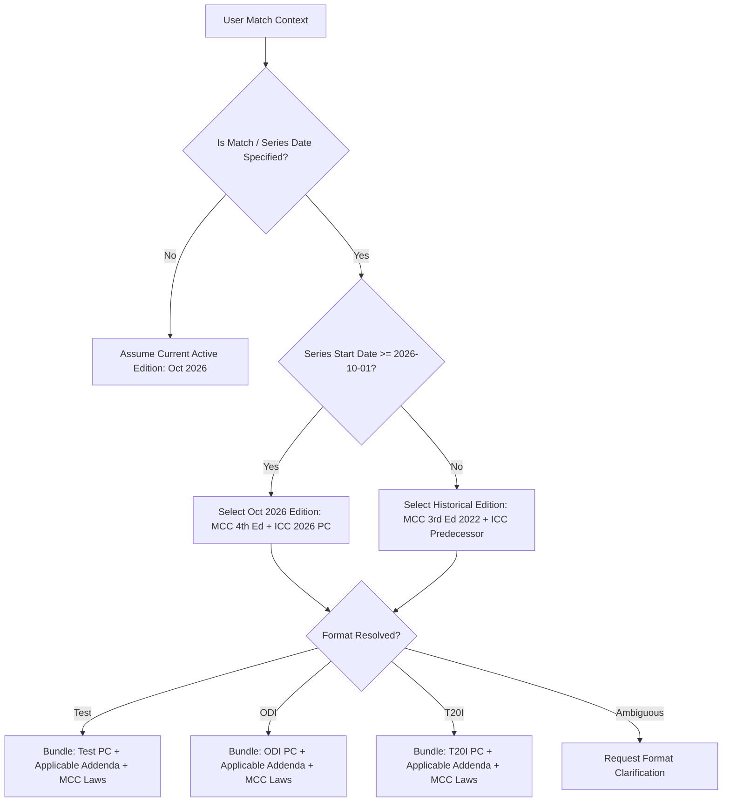

# Corpus Scope and Coverage Specification — CricketIQ

**Version:** 1.0.0  
**Effective Date:** 2026-11-16  
**Auditor:** CricketIQ Principal Knowledge Engineer & Architecture Team  

---

## 1. Scope Boundary Principles

CricketIQ is an authoritative, version-aware cricket rules assistant. It answers questions grounded exclusively in official regulatory evidence.

### Fundamental Scoping Rules
1. **Authoritative Exclusivity:** Only official MCC Laws and ICC Playing Conditions form the core regulatory corpus. Secondary explanations, commentary, news reports, and blog posts are prohibited from the authoritative evidence bundle.
2. **Context Resolution Before Retrieval:** Questions must be resolved to a specific format (Test, ODI, T20I), gender category (Men's, Women's), and applicable temporal interval before document candidates are retrieved.
3. **No Cross-Format Contamination:** A T20I-specific rule (e.g. Free Hit, 20-over maximums, 4-over bowler caps) must never be returned as an authoritative answer to a Test match inquiry.
4. **Out-of-Scope Confinement:** Requests regarding domestic franchise leagues (IPL, BBL, PSL) or unsupported recreational formats must trigger an explicit abstention/clarification citing corpus boundaries rather than guessing.

---

## 2. Multi-Format Coverage Matrix

| Format / Competition | Gender / Category | Governing Document ID | Baseline Law Reference | Key Differences from MCC Baseline | MVP Inclusion Status |
| :--- | :--- | :--- | :--- | :--- | :--- |
| **Men's Test Match** | Men's | `ICC_TEST_MEN_2026` | MCC Laws (2026 Ed) | 5-day duration, follow-on margins, DRS protocols, no Free Hit | **Core MVP (Tier 1)** |
| **Men's ODI** | Men's | `ICC_ODI_MEN_2026` | MCC Laws (2026 Ed) | 50 overs, 10-over bowler limit, 3 powerplay blocks, Free Hit on front-foot/all no-balls, DLS rain rule | **Core MVP (Tier 1)** |
| **Men's T20I** | Men's | `ICC_T20I_MEN_2026` | MCC Laws (2026 Ed) | 20 overs, 4-over bowler limit, 6-over powerplay, Free Hit on all no-balls (Clause 21.18), Super Over | **Core MVP (Tier 1)** |
| **Women's Test Match** | Women's | `ICC_TEST_WOMEN_2026` | MCC Laws (2026 Ed) | 4 or 5-day playing schedules, ball dimensions/specifications (Law 4.2 modification) | **Core MVP (Tier 1)** |
| **Women's ODI** | Women's | `ICC_ODI_WOMEN_2026` | MCC Laws (2026 Ed) | Ball specifications, boundary distance limits, fielding restrictions (powerplay) | **Core MVP (Tier 1)** |
| **Women's T20I** | Women's | `ICC_T20I_WOMEN_2026` | MCC Laws (2026 Ed) | Ball specifications, boundary distance limits, Free Hit provisions (Clause 21.18) | **Core MVP (Tier 1)** |
| **MCC Laws of Cricket** | Open / Universal | `MCC_LAWS_2026` | Custodian Baseline | 42 fundamental Laws of Cricket. Underlying baseline for all cricket formats worldwide | **Core MVP (Tier 1)** |
| **MCC Laws (2022 Ed)** | Open / Universal | `MCC_LAWS_2022` | Historical Baseline | Historical baseline for matches played prior to 1 October 2026 | **Historical Support** |
| **World Test Championship**| Men's | `ICC_WTC_2025_2027_PC` | `ICC_TEST_MEN_2026` | Points allocation, slow over-rate penalty deductions, Final playing conditions | **Tier 2 (Overlay)** |
| **Men's T20 World Cup** | Men's | `ICC_T20WC_MEN_2026` | `ICC_T20I_MEN_2026` | Reserve day playing conditions, Super Over tie-breakers, group tie-breaking rules | **Tier 2 (Overlay)** |
| **Indian Premier League** | Men's Franchise | `BCCI_IPL_*` | Out of Scope | Impact Player, two bouncers per over, wide review | **Tier 3 (Out of Scope)** |

---

## 3. Temporal Applicability & Transition Logic

### 3.1 The October 2026 Boundary Rule
In official ICC circulars and regulation releases:
- The **October 2026 Playing Conditions** took effect on **1 October 2026**.
- **Crucial Applicability Trigger:** The ICC declared that these playing conditions apply to *all international matches and series starting on or after 1 October 2026*.
- Matches that are part of an ongoing multi-match bilateral series or tournament that began prior to 1 October 2026 continue under the *previous* playing conditions (e.g. October 2024 / 2025 editions).

### 3.2 Applicability Resolution Rules
The Applicability Engine implements the following strict decision table:

---

## 4. Format Differences & Comparison Mapping

To support format-comparison queries (e.g., *"What is the difference between a wide in ODI and T20I?"* or *"Can a batter be out on a free hit in Test cricket?"*), the corpus maintains explicit cross-format mapping:

| Regulation Domain | Test Match (`ICC_TEST_MEN_2026`) | ODI (`ICC_ODI_MEN_2026`) | T20I (`ICC_T20I_MEN_2026`) |
| :--- | :--- | :--- | :--- |
| **Free Hit for No Ball** | Not Applicable (Law 21 baseline applies; runs awarded, no free hit delivery) | **Clause 21.18:** Mandatory Free Hit following any No Ball | **Clause 21.18:** Mandatory Free Hit following any No Ball |
| **Dismissals on Free Hit** | Standard dismissal rules apply to subsequent balls | Batter can only be out: Run out (Law 38), Hit the ball twice (Law 34), Obstructing the field (Law 37) | Batter can only be out: Run out (Law 38), Hit the ball twice (Law 34), Obstructing the field (Law 37) |
| **Wide Delivery Legality** | Strict judgment based on batter's normal guard and stance; leniency for off-side leaves | Strict leg-side guidelines: ball passing behind batter's legs is automatically Wide | Strict leg-side guidelines and off-side wide markings on crease |
| **Maximum Overs per Bowler** | Unlimited (governed only by physical endurance and rest intervals) | Maximum 10 overs per bowler (20% of scheduled 50 overs) | Maximum 4 overs per bowler (20% of scheduled 20 overs) |
| **Innings Duration & Cut-off**| 90 overs per day (minimum) | 3.5 hours per innings (50 overs) | 1 hour 25 minutes per innings (20 overs) |
| **In-Match Over-Rate Penalty**| Fines / WTC competition points deduction | Fielding restriction: 1 fewer fielder outside 30-yard circle for remaining overs | Fielding restriction: 1 fewer fielder outside 30-yard circle for remaining overs |
