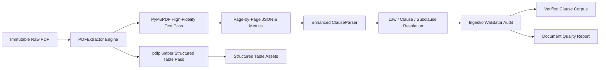

# Document Extraction and Layout Specification — CricketIQ

**Version:** 1.0.0  
**Effective Date:** 2026-11-16  
**Auditor:** CricketIQ Document AI & PDF Engineering Team  

---

## 1. Extraction Objectives & Immutable Invariants

CricketIQ operates on official regulatory PDF publications issued by the **International Cricket Council (ICC)** and **Marylebone Cricket Club (MCC)**. Legal cricket texts have strict structural constraints:
- **Hierarchical Numbering:** Law numbers 1–42, clauses (e.g. `21.18`), subclauses (e.g. `21.18.2`), and paragraph-level items (e.g. `21.18.3.1`).
- **Verbatim Text Immutability:** Raw extracted text must preserve exact wording, clause numbers, headings, punctuation, and conditions without summarization or lossy normalization.
- **Page & Location Provenance:** Every clause record maintains `page_start` and `page_end` tracing directly back to physical PDF pages.
- **Table Preservation:** Structured multi-row and multi-column tables (such as DLS resource percentage tables, boundary dimensions, and penalty point tables) must be extracted and preserved as structured JSON grids rather than discarded or collapsed into scrambled strings.

---

## 2. Multi-Stage Extraction Pipeline



### 2.1 Stage 1: PyMuPDF High-Fidelity Text Extraction
- Extracts all text streams page-by-page.
- Preserves reading order and block layout.
- Measures character count, unprintable/control characters, and detects empty or corrupt pages.
- Normalizes typography artifacts: handles narrow non-breaking space `\u202f` (used extensively in ICC InDesign layouts such as `No ball` and `clause 41.2`), non-breaking space `\xa0`, and layout tabs.

### 2.2 Stage 2: pdfplumber Table Extraction
- Detects table bounding boxes and cell matrices.
- Preserves headers, row order, column boundaries, and cell content.
- Generates dedicated table assets in `data/extracted/tables/` linking back to the enclosing document and page.

### 2.3 Stage 3: Enhanced Clause Parsing
- Detects major Law headers (`MAJOR_SECTION_RE`) for Laws 1 through 42.
- Detects standalone clause lines (`STANDALONE_CLAUSE_RE`) where clause numbers appear on an isolated line followed by headings or body text.
- Detects inline clause statements (`SUB_CLAUSE_INLINE_RE`) with clause body text.
- Rejects false-positive measurement lines (`UNITS_RE` with word boundary `\b`) such as `5.75 ounces`, `2.75 inches`, `0.04 inches`.
- Resolves 4-tier parent-child hierarchy:
  $$\text{Major Law (e.g. 21)} \rightarrow \text{Clause (21.18)} \rightarrow \text{Subclause (21.18.3)} \rightarrow \text{Paragraph (21.18.3.1)}$$
- Classifies clause types: `RULE`, `EXCEPTION`, `PENALTY`, `DEFINITION`, `PROCEDURE`.
- Extracts cross-references to other Laws and clauses.

---

## 3. Extracted Artifacts Directory Layout

```text
data/
  extracted/
    page_text/
      {doc_id}_pages.json          # Page-by-page raw text and metrics
    layout_json/
      {doc_id}_layout.json         # Document layout and page structure
    tables/
      {doc_id}_tables.json         # Structured table grids
    extraction_reports/
      {doc_id}_report.json         # Quality, completeness, and audit report
  corpus/
    clauses/
      {doc_id}_clauses.json        # Structured RuleClause objects
```

---

## 4. Extraction Quality & Acceptance Criteria

Every document must satisfy the following automated quality thresholds before activation:
1. **Zero Garbled Pages:** The ratio of non-printable or corrupted characters must be $< 1\%$.
2. **Completeness:** Expected page count must match actual physical PDF page count.
3. **No Orphan Clauses:** Every subclause must resolve to a valid parent clause within the document hierarchy or parent format condition.
4. **Authenticity:** All clause citations and text must match the source PDF verbatim.
