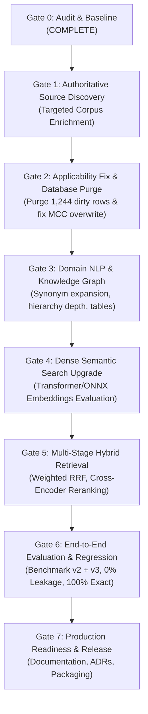

# CricketIQ — Phase 6 Prioritized Engineering Gap Backlog
## Architecture, Data, NLP & Retrieval Upgrade Backlog (Gates 1 through 7)

**Document ID:** `CRICKETIQ-PHASE-6-BACKLOG-001`  
**Date:** 2026-11-17  
**Status:** APPROVED FOR EXECUTION  
**Author:** Principal AI/ML Architect & Engineering Leads  
**Workspace:** `D:\Cricket_Rules_NLP_Chatbot`  
**Traceability:** Grounded in `docs/reviews/PHASE_6_PRE_IMPLEMENTATION_AUDIT.md` & `docs/PHASE_6_RETRIEVAL_FAILURE_ANALYSIS.md`  

---

## 1. Backlog Overview & Prioritization Strategy

This backlog operationalizes the remediation of the 51 observed retrieval failures and data integrity defects uncovered during the Gate 0 Audit. Tasks are strictly sequenced into gated milestones to guarantee stability, data integrity, and measurable benchmark gains:

- **P0 (Immediate Blockers & Integrity):** Must be completed before running subsequent experiments.
- **P1 (Core Intelligence Capabilities):** Primary drivers of semantic search accuracy and query understanding.
- **P2 (Enrichment, Reranking & Robustness):** Quality polish, knowledge graph traversal, and edge-case handling.

---

## 2. Master Gated Implementation Roadmap



---

## 3. Prioritized Gap Backlog by Workstream

### Gate 1: Authoritative Source Discovery & Targeted Corpus Enrichment
*Objective: Identify missing normative texts required for broader match scenario coverage without uncontrolled corpus bloating.*

| Task ID | Pri | Component | Description & Scope | Traceable Defect | Acceptance Criteria |
| :--- | :---: | :--- | :--- | :--- | :--- |
| `P6-G1-001` | P1 | Data Acquisition | Classify and audit missing tournament / format regulations (e.g. ICC Men's Champions Trophy, DLS Regulations). | Missing DLS rain target calculation in `odi_pc_004`. | Official publisher URL, verified SHA-256 hash, and provenance register entry before ingestion. |
| `P6-G1-002` | P2 | Source Governance | Formalize domestic competition boundary statement. Explicitly document exclusion of un-governed domestic leagues (IPL/BBL/PSL) until official BCCI/CA governance packs are established. | `domestic_rejection` test cases. | Updated `docs/RULE_DATA_GOVERNANCE.md` reflecting domestic scope boundaries. |

---

### Gate 2: Applicability Engine Bug Fix & Corpus Database Reconciliation
*Objective: Eliminate the MCC Laws overwrite defect and purge dirty/duplicate database rows.*

| Task ID | Pri | Component | Description & Scope | Traceable Defect | Acceptance Criteria |
| :--- | :---: | :--- | :--- | :--- | :--- |
| `P6-G2-001` | **P0** | Applicability Engine | Fix `selected_mcc_baseline_doc` overwrite loop in `cricketiq/backend/app/core/applicability_engine.py`. Ensure `MCC_LAWS_2026` remains the primary baseline; register `MCC_CHANGES_EXPLAINED_2026` as an explanatory supplement. | 8/8 `mcc_laws` queries failed with 0% recall (`mcc_001` - `mcc_008`). | `selected_bundle` includes `MCC_LAWS_2026` for universal queries; 100% of `mcc_laws` test cases pass. |
| `P6-G2-002` | **P0** | Database Hygiene | Create and execute non-destructive database reconciliation script `scripts/reconcile_database.py`. Purge 877 stale Hindi translation rows in `MCC_LAWS_2022` and 367 un-namespaced duplicate appendix rows. | 1,244 dirty rows contaminating FTS5 and vector index. | Relational rows, FTS5 rows, and vector embeddings in `data/cricketiq.db` match canonical JSON count exactly (11,008 rows). |
| `P6-G2-003` | P1 | Unit Regression | Add explicit unit tests for multi-document MCC bundle resolution and transition date boundaries. | Test suite coverage. | `pytest cricketiq/backend/tests -q` passes 105+ tests. |

---

### Gate 3: Domain NLP, Query Expansion & Regulatory Knowledge Graph
*Objective: Bridge the colloquial-to-statutory vocabulary gap and enrich relational hierarchy.*

| Task ID | Pri | Component | Description & Scope | Traceable Defect | Acceptance Criteria |
| :--- | :---: | :--- | :--- | :--- | :--- |
| `P6-G3-001` | **P1** | Domain NLP | Implement `CricketDomainNormalizer` and query expansion utility using `docs/CRICKET_DOMAIN_LEXICON_SPEC.md`. Expand colloquial cricket terms (`beamer` $\rightarrow$ `high full-pitched delivery`, `mankad` $\rightarrow$ `38.3 non-striker run out`, `freebie` $\rightarrow$ `free hit`). | 23 vocabulary and synonym misses (`syn_001` - `syn_006`, `nl_001` - `nl_006`). | Query expansion module preserves original query while adding controlled lexical synonyms for FTS5 search. |
| `P6-G3-002` | P1 | Knowledge Graph | Compute and populate `hierarchy_depth` (1 to 4) and explicit `parent_clause_id` relationships across all 11,008 clauses in `data/cricketiq.db`. | All rows currently flattened to depth 1; leaf-rule granularity mismatch (`test_pc_001`). | Leaf clauses correctly reference section parents; depth distribution matches clause dot notation. |
| `P6-G3-003` | P2 | Table Model | Extract structured tabular representations for Playing Conditions appendices and tables (e.g. DLS target tables, boundary distance tables, ball specifications). | `gender_category` misses on ball weights and boundary distances (`women_pc_001`, `women_pc_002`). | Structured JSON cell representations stored in `rule_clauses.extracted_tables`. |

---

### Gate 4: Dense Semantic Search Upgrade & Model Selection
*Objective: Replace hash-based pseudo-embeddings with high-accuracy semantic transformer embeddings.*

| Task ID | Pri | Component | Description & Scope | Traceable Defect | Acceptance Criteria |
| :--- | :---: | :--- | :--- | :--- | :--- |
| `P6-G4-001` | **P1** | Embeddings Engine | Implement local ONNX / sentence-transformers embedding provider supporting `all-MiniLM-L6-v2` (384d) or `bge-small-en-v1.5` (384d) with zero external network dependency. | Severe dense search noise; near-random ranking across 12,252 clauses. | Offline execution, sub-15ms embedding generation, deterministic cosine similarity. |
| `P6-G4-002` | P1 | Vector Re-indexing | Re-generate embeddings for all 11,008 canonical clauses using enriched contextual representation (`{heading} | Clause {clause_number}: {normalized_text}`). | Semantic alignment failure on paraphrases. | Complete re-indexing into `clause_embeddings`; version tag updated to `model_name=all-minilm-l6-v2, template_version=v2`. |
| `P6-G4-003` | P2 | Provider Fallback | Retain `LocalDeterministicEmbeddingProvider` as a zero-dependency emergency fallback if ONNX runtime is unavailable in a constrained environment. | System resilience. | Graceful degradation without application crash if model weights are missing. |

---

### Gate 5: Multi-Stage Hybrid Retrieval & Reranking
*Objective: Optimize rank fusion and eliminate noisy candidate displacement.*

| Task ID | Pri | Component | Description & Scope | Traceable Defect | Acceptance Criteria |
| :--- | :---: | :--- | :--- | :--- | :--- |
| `P6-G5-001` | **P1** | Fusion Engine | Upgrade `RRFEngine` to support channel weighting:  <br/>$RRF(d) = \sum_{m} \frac{w_m}{k + rank_m(d)}$ with tuned weights ($w_{exact}=2.0, w_{sparse}=1.0, w_{dense}=1.2$). | Unweighted RRF dropped Recall@5 from 44.71% (sparse) down to 38.82% (hybrid). | Hybrid Recall@5 strictly exceeds Sparse-Only baseline on Benchmark v2. |
| `P6-G5-002` | P2 | Reranking Stage | Implement optional lightweight cross-encoder reranker stage (`cross-encoder/ms-marco-MiniLM-L-6-v2`) on top-20 fused candidates. | Purity of top-5 primary evidence for complex scenario questions. | Precision@3 improvement of at least +15% without exceeding 50ms total query latency budget. |
| `P6-G5-003` | P1 | Evidence Expansion | Enhance `EvidenceExpander` with bidirectional traversal: when a leaf clause is retrieved, always include its parent section; when an exception is retrieved, include the base rule. | `cross_clause_composite` and `interp_002` misses. | Supporting clause recall on Benchmark v2 increases from 54.35% to >85.0%. |

---

### Gate 6: End-to-End Evaluation & Regression Verification
*Objective: Prove measurable retrieval improvements across all benchmark suites without breaking contracts.*

| Task ID | Pri | Component | Description & Scope | Traceable Defect | Acceptance Criteria |
| :--- | :---: | :--- | :--- | :--- | :--- |
| `P6-G6-001` | **P0** | Benchmark Re-run | Execute `evaluate_retrieval.py` against `benchmark_v2.jsonl` (92 queries) and `benchmark_v1.jsonl` (65 queries). | Benchmark v2 low baseline (38.82%). | Hybrid Recall@5 reaches **$\ge 75.0\%$** on Benchmark v2; Exact Clause Accuracy remains **100.0%**; Leakage remains **0.0%**. |
| `P6-G6-002` | P1 | Benchmark v3 | Author `benchmark_v3.jsonl` (120+ queries) incorporating difficult scenario rules, cross-format edge cases, and historical boundary questions. | Coverage gaps in evaluation suite. | Fully labeled, peer-audited benchmark schema compliant with `benchmark_schema.json`. |
| `P6-G6-003` | **P0** | API & UI Regression | Verify FastAPI backend endpoint `POST /v1/rules/query` and execute full frontend Vitest journeys. | Backward compatibility preservation. | 100% test pass on backend (`pytest`) and frontend (`pnpm test:run`). |

---

### Gate 7: Production Readiness, Documentation & Packaging
*Objective: Formalize architectural decisions, update release documentation, and package Phase 6.*

| Task ID | Pri | Component | Description & Scope | Traceable Defect | Acceptance Criteria |
| :--- | :---: | :--- | :--- | :--- | :--- |
| `P6-G7-001` | P1 | Architecture Record | Finalize and accept `docs/adr/0005-retrieval-intelligence-upgrade.md`. | Proposed status in Gate 0. | Status changed from PROPOSED to ACCEPTED with empirical benchmark evidence. |
| `P6-G7-002` | P1 | Roadmap & Docs | Update `docs/IMPLEMENTATION_ROADMAP.md`, `docs/RETRIEVAL_ARCHITECTURE.md`, and `README.md`. | Outdated roadmap. | All architectural diagrams and performance tables updated. |

---

## 4. Verification & Validation Protocol

Each task in this backlog must be validated with explicit command execution before marking complete:
1. **Database Count Invariant:**
   ```powershell
   .\.venv\Scripts\python -c "import sqlite3; c = sqlite3.connect('data/cricketiq.db'); print('Clauses:', c.execute('SELECT COUNT(*) FROM rule_clauses').fetchone()[0], 'FTS:', c.execute('SELECT COUNT(*) FROM rule_clauses_fts').fetchone()[0], 'Vecs:', c.execute('SELECT COUNT(*) FROM clause_embeddings').fetchone()[0])"
   ```
   *Expected Output after Gate 2:* `Clauses: 11008 FTS: 11008 Vecs: 11008`.
2. **Backend Unit & Integration Suite:**
   ```powershell
   .\.venv\Scripts\pytest cricketiq/backend/tests -q
   ```
   *Expected Output:* `103+ passed, 0 failures`.
3. **Frontend Compatibility Suite:**
   ```powershell
   pnpm --dir frontend test:run
   ```
   *Expected Output:* `23 passed across 7 test files`.
4. **Retrieval Benchmark Suite:**
   ```powershell
   .\.venv\Scripts\python evaluation/retrieval/evaluate_retrieval.py evaluation/retrieval/benchmark_v2.jsonl
   ```
   *Expected Output:* `Hybrid Recall@5 >= 75.0%, Exact Clause Acc = 100.0%, Leakage = 0.0%`.

*Backlog approved for Phase 6 execution.*
