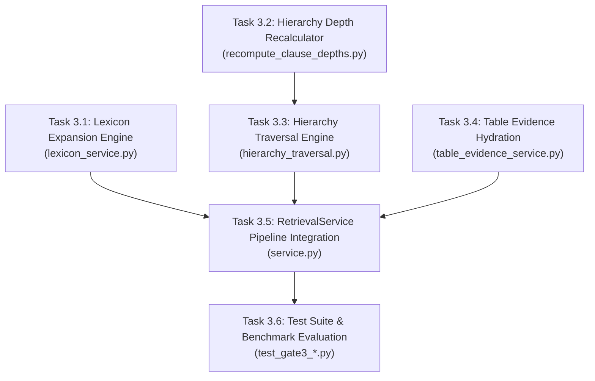

# CricketIQ — Phase 6 Gate 3 Detailed Implementation Plan

- **Date:** 2026-11-17
- **Document Version:** 1.0.0
- **Scope:** Technical Implementation Specification for Gate 3 (Cricket Domain Intelligence & Structured Regulatory Retrieval)
- **Status:** Ready for Execution (Post-Audit Design Package)
- **Prerequisites:** Phase 6 Gate 2 Remediation Fully Closed (`GATE 2 CLOSED — GATE 3 DESIGN READY`)

---

## 1. Objectives & Scope Boundaries

### Primary Objectives
1. Implement a **controlled query expansion engine** grounded in `data/corpus/lexicon/cricket_lexicon.json` with strict semantic non-equivalence guardrails.
2. Recompute and repair the **canonical clause hierarchy depth** (`hierarchy_depth = parent.depth + 1`) and sanitize missing parent links.
3. Implement a bounded, bundle-confined **Hierarchy Traversal Engine** providing parent definitional context and operational leaf children.
4. Integrate verified **structured table evidence** (`TableEvidence`) for quantitative and matrix regulations (DRS zones, Powerplay calculations).
5. Establish comprehensive **retrieval observability** (per-stage latency, expansion provenance traces, traversed hierarchy hops) while preserving 100% backward compatibility for the public API and frontend.

### Strict Scope Boundaries & Non-Goals
- **NON-GOAL 1: Public API Schema Changes.** `POST /v1/rules/query` request and response JSON schemas remain 100% frozen.
- **NON-GOAL 2: Frontend Modifications.** React UI and client contracts require zero alterations.
- **NON-GOAL 3: Transformer Embeddings (Gate 4).** Sentence-transformers, HuggingFace downloads, and ONNX models are strictly excluded; Gate 3 remains sparse-lexical and structural.
- **NON-GOAL 4: Cross-Encoder Re-ranking (Gate 5).** No weighted RRF or neural cross-encoders.
- **NON-GOAL 5: ADR 0005 Status Change.** ADR 0005 remains in `Proposed` status until empirical Gate 6 validation.

---

## 2. Gate 3 Typed Internal Retrieval Contracts

All Gate 3 extensions reside inside `cricketiq/backend/app/retrieval/` and do not leak into external API models:

```python
from enum import Enum
from typing import List, Optional, Dict, Any
from pydantic import BaseModel, Field

class EvidenceRole(str, Enum):
    DIRECT_EVIDENCE = "DIRECT_EVIDENCE"
    PARENT_CONTEXT = "PARENT_CONTEXT"
    OPERATIONAL_CHILD = "OPERATIONAL_CHILD"
    STATUTORY_CROSS_REFERENCE = "STATUTORY_CROSS_REFERENCE"
    TABLE_SPECIFICATION = "TABLE_SPECIFICATION"

class LexiconExpansionTrace(BaseModel):
    matched_term: str
    term_id: str
    expanded_phrases: List[str]
    distinct_from_suppressed: List[str]
    provenance_source: str = "cricket_lexicon.json"

class NormalizedQueryView(BaseModel):
    raw_query: str
    normalized_text: str
    tokens: List[str]
    extracted_clause_identifiers: List[str]
    expansions: List[LexiconExpansionTrace]
    is_contrastive: bool = False

class HierarchyTraversalRequest(BaseModel):
    seed_clause_id: str
    candidate_document_ids: List[str]
    include_parent: bool = True
    include_children: bool = True
    max_hops: int = 1

class HierarchyTraversalResult(BaseModel):
    seed_clause_id: str
    parent_clause: Optional[Dict[str, Any]] = None
    child_clauses: List[Dict[str, Any]] = Field(default_factory=list)
    resolved_cross_references: List[Dict[str, Any]] = Field(default_factory=list)
    unresolved_cross_references: List[str] = Field(default_factory=list)

class RetrievalObservabilityTrace(BaseModel):
    query_id: str
    raw_query: str
    normalized_view: NormalizedQueryView
    candidate_document_bundle: List[str]
    sparse_query_variants: List[str]
    direct_hits_count: int
    hierarchy_nodes_expanded: int
    table_evidence_ids: List[str]
    stage_latencies_ms: Dict[str, float]
```

---

## 3. Work Breakdown Structure & Task Schedule



### Task 3.1: Lexicon Expansion Engine with Non-Equivalence Gating
- **Module:** `cricketiq/backend/app/retrieval/nlp/lexicon_service.py`
- **Dependencies:** None.
- **Implementation:**
  - Loads `data/corpus/lexicon/cricket_lexicon.json`.
  - Implements `expand_query(raw_query: str) -> NormalizedQueryView`.
  - Enforces hard semantic invariants:
    - Never expand `retired hurt` $\rightarrow$ `retired out`.
    - Never expand `wide` $\rightarrow$ `no ball`.
    - Restrict `beamer` to high full-pitched delivery (Law 41.7 / Cl 21.5).
    - Map `mankad` $\rightarrow$ Law 38.3 (*Non-striker leaving ground early*).
  - Bounds expansion to $K \le 2$ phrases per term and max 3 terms per query.
- **Verification:** Unit tests in `cricketiq/backend/tests/test_lexicon_expansion.py`.

### Task 3.2: Canonical Hierarchy Depth Recalculation (Dry-Run & Staging)
- **Module:** `scripts/recompute_clause_depths.py`
- **Dependencies:** `scripts/reconcile_database.py`.
- **Implementation:**
  - Implements recursive tree depth computation from parent link chains.
  - Fixes the depth-1 anomaly across all 11 canonical JSON files.
  - Sanitizes the 349 missing parent links using structural section headers.
  - Performs non-destructive staging build and asserts 4-way ID digest invariance.
- **Verification:** `scripts/recompute_clause_depths.py --dry-run` and staging verification.

### Task 3.3: Bounded Hierarchy Traversal Engine
- **Module:** `cricketiq/backend/app/retrieval/hierarchy/traversal_service.py`
- **Dependencies:** Task 3.2.
- **Implementation:**
  - Implements `traverse(request: HierarchyTraversalRequest) -> HierarchyTraversalResult`.
  - Enforces bundle confinement: traversal never crosses outside the active candidate document bundle.
  - Hops up to parent (max 1 hop) and down to leaf children (max 1 hop).
  - Resolves intra-bundle cross-references; logs unresolved cross-references explicitly.
- **Verification:** Unit tests in `cricketiq/backend/tests/test_hierarchy_traversal.py`.

### Task 3.4: Structured Table Evidence Hydration
- **Module:** `cricketiq/backend/app/retrieval/tables/table_service.py`
- **Dependencies:** None.
- **Implementation:**
  - Loads audited tables from `data/extracted/tables/`.
  - Exposes `get_table_evidence_for_clause(clause_id: str) -> List[TableEvidence]`.
  - Formats tables cleanly into Markdown context blocks for LLM prompt augmentation.
- **Verification:** Unit tests in `cricketiq/backend/tests/test_table_evidence.py`.

### Task 3.5: RetrievalService Pipeline Integration
- **Module:** `cricketiq/backend/app/retrieval/service.py`
- **Dependencies:** Tasks 3.1, 3.3, 3.4.
- **Implementation:**
  - Integrates controlled lexicon expansion into the FTS5 query formulation stage.
  - Expands retrieved top hits with parent context and operational children within strict token budgets ($T \le 1,200$ tokens).
  - Hydrates table evidence where explicit clause links exist.
  - Records execution metrics in `RetrievalObservabilityTrace`.
- **Verification:** Integration tests in `cricketiq/backend/tests/test_retrieval_service_gate3.py`.

### Task 3.6: Verification & Benchmark Evaluation
- **Execution:**
  - Run full backend test suite: `pytest cricketiq/backend/tests -v`.
  - Run frontend test suite: `npm --prefix frontend run test:run`.
  - Run benchmark harness: `python evaluation/retrieval/evaluate_retrieval.py evaluation/retrieval/benchmark_v2.jsonl`.
- **Acceptance Criteria:**
  - Exact Clause Accuracy: **100.0%**.
  - Regulatory Leakage: **0.0%**.
  - Sparse-Only Recall@5: Target **$\ge 52.0\%$** (improvement over 47.06% baseline via synonym bridge).
  - P95 Retrieval Latency: **$\le 75\text{ms}$**.

---

## 4. Rollback and Risk Mitigation Strategy

| Risk Scenario | Probability | Impact | Mitigation Strategy | Rollback Protocol |
| :--- | :---: | :---: | :--- | :--- |
| **Query Inflation in FTS5:** Expanded terms cause BM25 score dilution. | Low | Medium | Strict cap of $\le 2$ phrases per term. Expansions weighted with $0.6 \times$ factor relative to original tokens. | Feature flag `enable_lexicon_expansion=False` in `RetrievalService`. |
| **Hierarchy Context Bloat:** Adding parent and child clauses exceeds LLM token limits. | Medium | Medium | Strict token budget of 1,200 tokens. Parent snippets prioritized over leaf children; truncation of lowest scores. | Feature flag `enable_hierarchy_traversal=False`. |
| **Database Corruption during Depth Migration:** Staging build fails or corrupts records. | Very Low | Critical | Reconcile promotion protocol asserts active DB SHA invariance and creates immutable rollback snapshot. | Automatic restore from `data/backups/cricketiq_rollback_*.db`. |
