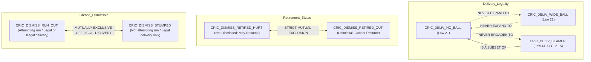

# Cricket Domain Lexicon Audit & Controlled Query Expansion Specification (Gate 3)

- **Date:** 2026-11-17
- **Document Version:** 1.0.0
- **Scope:** Phase 6 Gate 3 Pre-Implementation Audit
- **Data Asset:** `data/corpus/lexicon/cricket_lexicon.json`
- **Companion Specifications:** `docs/CRICKET_DOMAIN_LEXICON_SPEC.md`, `docs/reviews/PHASE_6_GATE_3_PRE_IMPLEMENTATION_AUDIT.md`

---

## 1. Executive Summary

Cricket regulations present an exceptionally high density of specialized legal and technical terminology. Natural language user queries frequently employ colloquialisms, historical terms, or loose phrasing (e.g., *"mankading"*, *"beamer"*, *"freebie"*, *"overstepping"*), whereas official regulatory corpora (MCC Laws of Cricket and ICC Playing Conditions) formulate rules using strict statutory language (*"Law 38.3 Non-striker leaving their ground early"*, *"Clause 21.5 High full-pitched delivery"*, *"Clause 21.18 Free Hit after a No ball"*).

Lexical query expansion bridging these domains is critical to improving Sparse-Only retrieval Recall@5 without degrading exact-match precision. However, naive or uncontrolled synonym expansion poses severe risks of **legal hallucinations** and **regulatory boundary violations** (e.g., conflating a *Wide* with a *No ball*, or treating *Retired Hurt* as a *Dismissal*).

This document audits all 20 existing terms in `cricket_lexicon.json`, establishes **hard semantic non-equivalence invariants**, analyzes their impact on the 92 Benchmark v2 queries, and specifies the architecture for **controlled, provenance-tracked query expansion**.

---

## 2. Comprehensive Lexicon Audit Matrix

The following matrix provides an exhaustive analysis of the 20 registered terms in `data/corpus/lexicon/cricket_lexicon.json`:

| Term ID | Preferred Term & Type | Surface Forms & Variants | Colloquial Query Forms | Canonical Statutory Phrase | Source References | `distinct_from` Constraints | Review State | Benchmark v2 Queries Affected | Ambiguity Risk & Expansion Policy |
| :--- | :--- | :--- | :--- | :--- | :--- | :--- | :---: | :--- | :--- |
| **`CRIC_DELIV_NO_BALL`** | No ball<br>*(DELIVERY_LEGALITY)* | `No ball`, `no-ball`, `no ball`, `No-ball`, `NB` | `noball`, `overstepping`, `front foot fault`, `front foot no ball` | *"Call and signal of No ball"*, *"Bowler overstepping popping crease"* | MCC Law 21, ICC Clause 21 | `Wide ball`, `Dead ball` | **APPROVED** | `exact_010`, `phrase_005`, `nl_001`, `nl_006`, `syn_006`, `interp_001`, `interp_002`, `interp_006` (15 queries) | **Moderate.** Risk of conflating with Wide. Never expand to Wide. In T20I/ODI, associate with Free Hit penalty; in Test, no free hit applies. |
| **`CRIC_DELIV_WIDE_BALL`** | Wide ball<br>*(DELIVERY_LEGALITY)* | `Wide ball`, `wide ball`, `Wide`, `wide`, `WD` | `wides`, `down leg side`, `outside tramline`, `wide guideline` | *"Call and signal of Wide ball"*, *"Ball passing wide of the striker"* | MCC Law 22, ICC Clause 22 | `No ball`, `Dead ball`, `Bye` | **APPROVED** | `phrase_002`, `nl_003`, `syn_004`, `interp_001`, `interp_002`, `interp_004`, `interp_005`, `interp_006` (11 queries) | **High.** If delivery satisfies No ball conditions, No ball takes precedence over Wide. Never expand across No ball boundary. |
| **`CRIC_DELIV_DEAD_BALL`** | Dead ball<br>*(DELIVERY_LEGALITY)* | `Dead ball`, `dead ball`, `Dead Ball` | `ball dead`, `play stopped`, `dead-ball` | *"Ball ceases to be in play"*, *"Ball becoming dead"* | MCC Law 20, ICC Clause 20 | `No ball`, `Wide ball` | **APPROVED** | `interp_001`, `cross_002` (2 queries) | **Low.** Distinct state of play where no dismissals or runs can occur. Safe for literal synonym expansion. |
| **`CRIC_DELIV_FREE_HIT`** | Free Hit<br>*(PENALTY_AWARD)* | `Free Hit`, `free hit`, `Free hit`, `free-hit` | `freebie`, `free shot`, `free ball` | *"Free Hit after a No ball"*, *"Fielding restrictions on Free Hit"* | ICC Playing Conditions Clause 21.18 | `Penalty run`, `Powerplay` | **APPROVED** | `phrase_001`, `nl_001`, `nl_005`, `cross_001`, `cross_002`, `cross_003`, `cross_004` (16 queries) | **Critical.** Applies strictly in White-Ball (ODI, T20I) PCs, NOT in MCC Laws baseline or Men's Test PC. Format gating mandatory. |
| **`CRIC_DELIV_BEAMER`** | High full-pitched delivery<br>*(DELIVERY_LEGALITY)* | `High full-pitched delivery`, `high full pitch`, `waist high full toss` | `beamer`, `waist high toss`, `dangerous full toss` | *"High full-pitched delivery above waist height"* | MCC Law 41.7, ICC Clause 21.5 | `Bouncer`, `Short-pitched delivery` | **APPROVED** | `exact_008`, `syn_002`, `nl_002` (3 queries) | **High.** Beamer is a specific subcategory of dangerous delivery resulting in a No ball. Never expand generic "no ball" to beamer. |
| **`CRIC_DELIV_BOUNCER`** | Short-pitched delivery<br>*(DELIVERY_LEGALITY)* | `Short-pitched delivery`, `short pitched ball`, `bouncer` | `bumper`, `head high ball`, `shoulder high ball` | *"Fast short-pitched delivery above shoulder height"* | MCC Law 41.6, ICC Clause 21.6 | `High full-pitched delivery`, `Beamer` | **APPROVED** | `interp_006` (1 query) | **Moderate.** Governs limits per over (2 in Tests/ODIs, 1 in T20Is). Distinct from beamers (unbounced deliveries). |
| **`CRIC_DISMISS_BOWLED`** | Bowled<br>*(DISMISSAL_METHOD)* | `Bowled`, `bowled`, `Bowled out` | `clean bowled`, `stumps shattered`, `castled`, `knocked over` | *"Bowled"*, *"Wicket put down by the ball delivered"* | MCC Law 32, ICC Clause 32 | `Hit wicket`, `Stumped` | **APPROVED** | None direct in benchmark (Baseline concept) | **Low.** Primary mode of dismissal. Takes precedence over LBW and Caught. |
| **`CRIC_DISMISS_CAUGHT`** | Caught<br>*(DISMISSAL_METHOD)* | `Caught`, `caught`, `Catch`, `catch` | `caught out`, `taken at slip`, `held by fielder` | *"Caught"*, *"Ball touched by striker's bat or glove and held by fielder"* | MCC Law 33, ICC Clause 33 | `Bump ball`, `Ground contact` | **APPROVED** | `cross_005`, `mcc_law_005` (2 queries) | **Moderate.** Requires ball not to touch ground. Excluded on Free Hit deliveries. |
| **`CRIC_DISMISS_LBW`** | Leg Before Wicket<br>*(DISMISSAL_METHOD)* | `Leg Before Wicket`, `LBW`, `lbw`, `leg-before-wicket` | `trapped in front`, `pad first`, `leg before` | *"Leg before wicket"*, *"Interception of ball striking the person"* | MCC Law 36, ICC Clause 36 | `Caught`, `Bowled` | **APPROVED** | `cross_003`, `cross_005` (2 queries) | **Moderate.** Subsumes Hawk-Eye pitching, impact, and wicket zone criteria in DRS. Excluded on Free Hit deliveries. |
| **`CRIC_DISMISS_RUN_OUT`** | Run out<br>*(DISMISSAL_METHOD)* | `Run out`, `run out`, `Run Out`, `run-out` | `runout`, `direct hit`, `short of crease while running` | *"Run out"*, *"Batter out of their ground while the ball is in play"* | MCC Law 38, ICC Clause 38 | `Stumped` | **APPROVED** | `cross_001`, `domestic_001`, `mcc_law_002` (3 queries) | **High.** Can occur off a No ball and off a Free Hit delivery. Distinct from Stumped (which requires legal ball and not attempting run). |
| **`CRIC_DISMISS_STUMPED`** | Stumped<br>*(DISMISSAL_METHOD)* | `Stumped`, `stumped`, `Stumping`, `stumping` | `stumped by keeper`, `wicketkeeper stumping` | *"Stumped"*, *"Striker out of ground otherwise than in attempting a run"* | MCC Law 39, ICC Clause 39 | `Run out` | **APPROVED** | `exact_003`, `nl_002`, `nl_004`, `syn_002`, `syn_004`, `cross_002` (27 queries) | **Critical.** Cannot occur off a No ball or Free Hit. Striker must NOT be attempting a run. If attempting a run, it is Run Out. |
| **`CRIC_DISMISS_HIT_WICKET`** | Hit wicket<br>*(DISMISSAL_METHOD)* | `Hit wicket`, `hit wicket`, `Hit Wicket` | `breaking wicket with bat`, `trod on stumps` | *"Hit wicket"*, *"Striker's person or equipment putting down the wicket"* | MCC Law 35, ICC Clause 35 | `Bowled`, `Stumped` | **APPROVED** | `cross_003` (1 query) | **Low.** Excluded on Free Hit deliveries. Occurs while playing stroke or setting off. |
| **`CRIC_DISMISS_HIT_BALL_TWICE`** | Hit the ball twice<br>*(DISMISSAL_METHOD)* | `Hit the ball twice`, `hit ball twice`, `double hit` | `hitting twice`, `second strike` | *"Hit the ball twice"*, *"Striker willfully striking the ball second time"* | MCC Law 34, ICC Clause 34 | `Obstructing the field` | **APPROVED** | `cross_004` (1 query) | **High.** ONE OF ONLY 3 DISMISSALS PERMITTED ON A FREE HIT. Second contact purely to defend wicket is lawful. |
| **`CRIC_DISMISS_OBSTRUCTING_FIELD`** | Obstructing the field<br>*(DISMISSAL_METHOD)* | `Obstructing the field`, `obstructing field` | `blocking fielder`, `willful obstruction`, `kicking ball away from stumps` | *"Obstructing the field"*, *"Willful obstruction or distraction by batter"* | MCC Law 37, ICC Clause 37 | `Hit the ball twice` | **APPROVED** | `cross_002` (1 query) | **High.** ONE OF ONLY 3 DISMISSALS PERMITTED ON A FREE HIT. Includes handling the ball willfully without consent. |
| **`CRIC_DISMISS_TIMED_OUT`** | Timed out<br>*(DISMISSAL_METHOD)* | `Timed out`, `timed out`, `Timed Out` | `time out`, `batter taking too long`, `delaying entry` | *"Timed out"*, *"Incoming batter failing to be ready to receive ball"* | MCC Law 31, ICC Clause 31 | `Retired out` | **APPROVED** | `mcc_law_001` (1 query) | **Critical Differential.** MCC Law allows 3 minutes. International Playing Conditions allow 2 minutes. Temporal PC overlay must apply. |
| **`CRIC_DISMISS_RETIRED_OUT`** | Retired out<br>*(DISMISSAL_METHOD)* | `Retired out`, `retired out`, `Retired - out` | `voluntary retirement without injury`, `tactical retirement` | *"Batter retiring without consent"*, *"Recorded as Retired - out"* | MCC Law 25.4.3 | `Retired not out`, `Retired hurt` | **APPROVED** | Baseline concept | **Critical Invariant.** Recorded as a DISMISSAL. Batter CANNOT resume innings under any circumstances. |
| **`CRIC_DISMISS_RETIRED_HURT`** | Retired hurt<br>*(STATUS_DESIGNATION)* | `Retired hurt`, `retired hurt`, `Retired - not out (illness)` | `injured batter retirement`, `concussion retirement`, `illness leaving field` | *"Batter retiring owing to illness, injury or other unavoidable cause"* | MCC Law 25.4.2 | `Retired out` | **APPROVED** | Baseline concept | **Critical Invariant.** NOT A DISMISSAL. Batter may resume innings at the fall of any subsequent wicket. NEVER expand to retired out. |
| **`CRIC_TECH_DRS`** | Decision Review System<br>*(TECHNICAL_PROTOCOL)* | `Decision Review System`, `DRS`, `drs` | `player review`, `umpire review`, `third umpire referral`, `ball tracking` | *"DRS Regulations"*, *"Player Review Protocol"* | ICC Playing Conditions Appendix D | `Third umpire TV referral`, `Concussion review` | **APPROVED** | `test_pc_003`, `odi_pc_003` (2 queries) | **High.** Governs 15-second timer, retained reviews for Umpire's Call, and television evidence protocols. |
| **`CRIC_TECH_DLS`** | Duckworth-Lewis-Stern Method<br>*(TECHNICAL_PROTOCOL)* | `Duckworth-Lewis-Stern Method`, `DLS`, `DLS Method`, `D/L Method` | `rain rule`, `revised target calculation`, `rain delay calculation` | *"Calculation of Target Score"*, *"Duckworth/Lewis/Stern Regulations"* | ICC Playing Conditions Appendix C | `VJD Method`, `Average run rate` | **APPROVED** | `odi_pc_004` (1 query) | **Moderate.** Governs target score adjustment in rain-interrupted limited overs matches. Requires minimum 20 overs (ODI) or 5 overs (T20I). |
| **`CRIC_NON_STRIKER_RUN_OUT`** | Non-striker leaving ground early<br>*(DISMISSAL_METHOD)* | `Non-striker leaving ground early`, `running out non-striker` | `mankad`, `mankading`, `backing up too far`, `bowler running out non striker` | *"Non-striker leaving their ground early"* | MCC Law 38.3, ICC Clause 38.3 | `Unfair play penalty` | **APPROVED** | None direct in benchmark (High volume user inquiry) | **Critical Invariant.** Fully legitimate Run out under Law 38. Moved out of Law 41 (Unfair Play) in 2022. "Mankad" is purely a search alias. |

---

## 3. Hard Semantic Non-Equivalence Invariants

The lexicon and retrieval expansion engine must enforce the following ten inviolable semantic boundaries:



### Invariant Specifications

1. **`Retired hurt` $\neq$ `Retired out`:**
   - Under MCC Law 25.4.2, a batter retiring due to illness, injury, or other unavoidable cause is recorded as `Retired - not out` and is entitled to resume their innings at the fall of a wicket.
   - Under MCC Law 25.4.3, a batter retiring for any other reason without the umpire's consent is recorded as `Retired - out` (a statutory dismissal) and cannot resume.
   - **Enforcement:** Never expand `retired hurt` $\rightarrow$ `retired out` or vice versa.
2. **`Wide ball` $\neq$ `No ball`:**
   - Under MCC Law 21/22 and ICC Clause 21/22, a delivery cannot be simultaneously scored as both a Wide and a No ball. If a delivery meets the criteria for both (e.g., passing wide of the striker while the bowler oversteps the popping crease), the call of **No ball takes absolute statutory precedence**.
   - **Enforcement:** Do not substitute "wide" for "no ball" in query expansion.
3. **`Run out` $\neq$ `Stumped`:**
   - Under Law 39, a batter is Stumped only if the delivery is not a No ball and the batter is out of their ground *otherwise than in attempting a run*. If the batter is attempting a run, the dismissal is strictly Run out (Law 38).
   - **Enforcement:** Keep distinct; do not merge candidate clauses for Law 38 and Law 39.
4. **`Bye` $\neq$ `Leg bye`:**
   - Under Law 23, Byes require the ball to pass the striker without touching their bat or person. Leg byes require the ball to strike the batter's person (not bat/glove) while playing a stroke or attempting to evade injury.
   - **Enforcement:** Distinct scoring categories; never treat as synonyms.
5. **`Free Hit` Dismissal Constraints:**
   - On a Free Hit delivery (ICC Clause 21.18.2), a batter can **ONLY** be dismissed by:
     1. Hit the ball twice (Law 34)
     2. Obstructing the field (Law 37)
     3. Run out (Law 38)
   - A question asking *"Can a batter be bowled on a free hit?"* must not return Bowled as an acceptable dismissal.
   - **Enforcement:** Ground Free Hit questions in Clause 21.18 and explicitly filter out non-permitted dismissal methods.
6. **`Beamer` $\subset$ `No ball` (Unilateral Subsumption):**
   - Every beamer is a No ball (and triggers a first-and-final warning under Clause 21.5), but only a tiny fraction of No balls are beamers (most are front-foot crease violations).
   - **Enforcement:** Queries mentioning "beamer" can safely expand to `"high full-pitched delivery"`, but generic "no ball" queries must never inject "beamer".
7. **`Mankad` is an Alias, Not a Statutory Category:**
   - "Mankad" does not appear in official regulations. The statutory provision is MCC Law 38.3 / ICC Clause 38.3 (*"Non-striker leaving their ground early"*).
   - **Enforcement:** Map "mankad" to Law 38.3 directly, preserving the clarification that it is a fully legitimate Run out dismissal.

---

## 4. Controlled Query Expansion Architecture for Gate 3

To prevent query drift and legal hallucinations, the Gate 3 expansion engine must satisfy the following architectural invariants:

### A. Strict Query Immutability
- The user's raw query string (`raw_query`) remains 100% immutable across the entire lifecycle.
- It is never rewritten, overwritten, or modified in place.

### B. View-Layer Controlled Expansion
Expansions are generated as structured query objects during sparse search preparation:

```python
class LexiconExpansionTrace(BaseModel):
    matched_token: str
    term_id: str
    expanded_phrases: List[str]
    provenance_source: str
    distinct_from_exclusions: List[str]

class NormalizedQueryView(BaseModel):
    raw_query: str
    normalized_text: str
    tokens: List[str]
    extracted_clause_identifiers: List[str]
    expansions: List[LexiconExpansionTrace]
```

### C. Negation and Contrast Preservation
- If a query contains contrastive operators (`not`, `versus`, `vs`, `except`, `difference between`), the expansion engine:
  1. Detects contrastive intent.
  2. Suppresses cross-term expansion.
  3. Formulates a compound search targeting the respective explicit clauses (e.g., `interp_001` targets both Law 21 and Law 22 without conflating them).

### D. Expansion Bounding & FTS Complexity Caps
- Maximum expanded terms per query: $N \le 3$.
- Maximum phrases per matched term: $K \le 2$.
- Recursive synonym expansion is strictly forbidden: expansion depth is bounded to 1 hop.

---

## 5. Verification Plan & Acceptance Criteria

1. **Schema Validation:** Implement `LexiconValidator` ensuring every record in `cricket_lexicon.json` satisfies `review_status in ["APPROVED", "DRAFT", "DEPRECATED"]`, has non-empty `distinct_from`, and links to existing canonical clauses.
2. **Expansion Safety Tests:**
   - Assert `retired hurt` never matches `MCC_LAWS_2026:25.4.3`.
   - Assert `wide` never injects `no-ball` into sparse FTS queries.
   - Assert `beamer` targets `21.5` / `41.7` specifically.
   - Assert `free hit` queries ground in `21.18` and respect the 3 permitted dismissals.
3. **Regression Guarantee:** Zero drop in Exact Clause Accuracy (100.0%) and zero increase in Regulatory Leakage (0.0%) on Benchmark v2.
