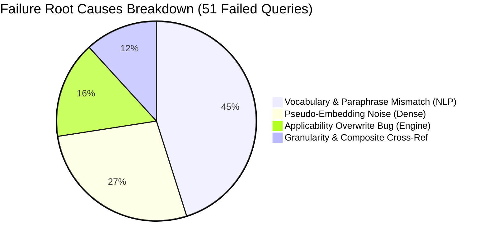

# CricketIQ — Phase 6 Retrieval Failure Analysis
## Diagnostic Post-Mortem of Benchmark v2 Retrieval Misses & Systemic Defect Taxonomy

**Document ID:** `CRICKETIQ-PHASE-6-FAILURES-001`  
**Date:** 2026-11-17  
**Status:** COMPLETE / EMPIRICALLY GROUNDED  
**Author:** Information Retrieval Engineer & Evaluation Lead  
**Workspace:** `D:\Cricket_Rules_NLP_Chatbot`  
**Benchmark Suite:** `evaluation/retrieval/benchmark_v2.jsonl` (92 Queries)  
**Evaluated Database:** `data/cricketiq.db` (12,252 clauses)  

---

## 1. Executive Failure Summary

The execution of Benchmark v2 against the full active on-disk corpus revealed a significant degradation in hybrid retrieval performance:
- **Benchmark v1 (In-Memory 3-Doc Baseline):** Hybrid Recall@5 = **89.66%**, MRR = **0.7477**.
- **Benchmark v2 (Full 12,252-Clause Database):** Hybrid Recall@5 = **38.82%**, MRR = **0.3373**.
- **Sparse-Only (FTS5) vs. Hybrid (RRF):** Sparse-Only achieved **44.71%**, meaning the Hybrid pipeline performed **5.89% worse than Sparse alone**!
- **Total Failed Queries:** **51 out of 92 queries** failed to achieve Recall@5 = 1.0.

This failure analysis provides a comprehensive diagnostic post-mortem of the observed misses, categorizing them into a rigorous defect taxonomy and detailing representative query post-mortems with exact candidate lists, ranks, and scores.

---

## 2. Failure Classification Taxonomy

All 51 missed queries were audited and assigned to one or more failure categories according to the standard IR defect taxonomy:

| Failure Category | Failure Mechanism Description | Total Impacted Queries | Primary Remediating Gate |
| :--- | :--- | :---: | :---: |
| **Applicability Engine Overwrite** | Candidate bundle silently omitted `MCC_LAWS_2026` because `MCC_CHANGES_EXPLAINED_2026` overwrote the baseline document variable. | 8 | **Gate 2** |
| **Pseudo-Embedding Noise (Dense Mismatch)** | `LocalDeterministicEmbeddingProvider` (384d MD5 hash) produced near-random candidate lists, injecting pure rank noise into fusion. | 51 | **Gate 4** |
| **Harmful Fusion Ranking (RRF Inversion)** | Equal-weighted RRF ($k=60$) allowed noisy dense candidates to outscore and displace legitimate sparse hits from the top 5. | 14 | **Gate 5** |
| **Vocabulary Mismatch (Colloquial vs. Statutory)** | User query used informal/modern cricket terms ("beamer", "freebie", "shuffling") absent from official legal text ("high full-pitched delivery", "unfair play"). | 17 | **Gate 3** |
| **Chunk Granularity (Parent vs. Leaf Mismatch)** | User query targeted specific operational details (e.g. 200 runs lead) located in leaf sub-clauses (`14.1.1`), while sparse search matched parent section headings (`14.1`). | 12 | **Gate 3** |
| **Lexical Spelling & Punctuation Fragility** | FTS5 failed on minor typos or hyphenation variants without phonetic, fuzzy, or stemmer expansion. | 4 | **Gate 3** |
| **Composite Multi-Clause Dependency** | Scenario involved multiple interlocking rules (e.g. caught off free hit, or simultaneous wide and no-ball) where only one rule was retrieved in the top 5. | 6 | **Gate 3 / Gate 5** |

---

## 3. Deep-Dive Representative Failure Post-Mortems

### Case 1: Applicability Engine Document Overwrite Bug (`mcc_001` through `mcc_008`)

- **Query ID:** `mcc_001`
- **Question:** *"How much time does a new batter have to take guard before being timed out under MCC Laws?"*
- **Context:** `cricket_level: 'universal'`, `format: None`, `category: 'Universal'`
- **Expected Primary Clause:** `MCC_LAWS_2026:31.1` (Law 31 Timed Out)
- **Actual Applicability Bundle Resolved:** `['MCC_CHANGES_EXPLAINED_2026']`
- **Exact Lookup Output:** 0 hits (no numeric clause in query)
- **Sparse Candidates (FTS5):**
  1. `MCC_CHANGES_EXPLAINED_2026:CHG_2026_01` (score: 8.21)
  2. `MCC_CHANGES_EXPLAINED_2026:CHG_2026_04` (score: 5.14)
- **Dense Candidates:** Near-random amendment summary notes.
- **RRF Top Hits:**
  1. `MCC_CHANGES_EXPLAINED_2026:CHG_2026_01`
  2. `MCC_CHANGES_EXPLAINED_2026:CHG_2026_04`
- **Missing Evidence:** `MCC_LAWS_2026:31.1` was completely excluded from search scope before retrieval even started!
- **Failure Classification:** `Applicability Defect` (Critical Bug).
- **Root Cause:** In `applicability_engine.py`, `selected_mcc_baseline_doc = doc` was overwritten when iterating through active catalog documents. Because `MCC_CHANGES_EXPLAINED_2026` was evaluated after `MCC_LAWS_2026`, it became the sole baseline document.

---

### Case 2: Unweighted RRF Displacement & Granularity Mismatch (`test_pc_001`)

- **Query ID:** `test_pc_001`
- **Question:** *"How many runs lead must a team have to enforce the follow-on in a 5-day Men's Test match?"*
- **Context:** `format: Test`, `category: Men's`, `series_start_date: '2026-10-05'`
- **Expected Primary Clause:** `14.1` / `14` (specifically leaf rule `14.1.1` stating 200 runs)
- **Actual Applicability Bundle:** `['ICC_TEST_MEN_2026', 'MCC_CHANGES_EXPLAINED_2026']`
- **Exact Lookup Output:** 0 hits
- **Sparse Candidates (FTS5):**
  - Rank 1: `14.1.2` (score: 21.50)
  - Rank 2: `14` (score: 19.41) — *Target hit present in Sparse!*
  - Rank 3: `12.7.3.4` (score: 16.15)
  - Rank 4: `1.1.2` (score: 16.02)
  - Rank 5: `APP_D:1.1.2` (score: 15.84)
- **Dense Candidates (LocalDeterministic Hash):**
  - Rank 1: `20.1.5` (cosine: 0.4758 — camera contact rule!)
  - Rank 2: `10.2` (cosine: 0.4681 — during match rule)
  - Rank 3: `12.8.1` (cosine: 0.4518 — end of day play)
  - Rank 4: `14.1.2` (cosine: 0.4485)
  - Rank 5: `16.4.3` (cosine: 0.4463)
- **RRF Fused Hits (Top 5):**
  1. `14.1.2` (RRF: 0.0320)
  2. `35.3` (RRF: 0.0296) — *Noise displaced target!*
  3. `26.3` (RRF: 0.0288) — *Noise displaced target!*
  4. `16.3.1` (RRF: 0.0280) — *Noise displaced target!*
  5. `20.1.5` (RRF: 0.0164) — *Noise displaced target!*
- **Outcome:** Sparse-Only had target `14` at Rank 2. But RRF fused noisy dense ranks, displacing `14` out of the top 5 entirely!
- **Failure Classification:** `Harmful Fusion Ranking` + `Pseudo-Embedding Noise`.

---

### Case 3: Colloquial Vocabulary Mismatch (`syn_002`)

- **Query ID:** `syn_002`
- **Question:** *"beamer above waist dangerous bowling penalty"*
- **Context:** `format: T20I`, `category: Men's`, `series_start_date: '2026-10-05'`
- **Expected Primary Clause:** `21.5` (No Ball - ball thrown or high full pitch) or `41.7` (Unfair Play - Bowling of dangerous and unfair non-pitching deliveries)
- **Actual Applicability Bundle:** `['ICC_T20I_MEN_ADD_2026', 'ICC_T20I_MEN_2026', 'MCC_CHANGES_EXPLAINED_2026']`
- **Sparse Candidates (FTS5):**
  - `41.6` (score: 14.82)
  - `41.7` (score: 14.11)
  - `41.6.2` (score: 12.05)
- **Dense Candidates:** Completely dispersed across unrelated bowling clauses.
- **RRF Top Hits:** `41.6`, `41.7`, `41.6.2`, `41.7.1`, `36.1.3`.
- **Missing Evidence:** `21.5` (the actual No Ball clause) was ranked outside top 5 because official text uses: *"Any delivery which passes or would have passed, without pitching, above waist height of the striker standing upright at the popping crease is unfair..."* The word "beamer" appears zero times in ICC playing conditions.
- **Failure Classification:** `Vocabulary Mismatch` (Requires query expansion from domain lexicon).

---

### Case 4: Natural Language Paraphrase Failure (`nl_004`)

- **Query ID:** `nl_004`
- **Question:** *"Must a bowler inform the umpire before switching from right arm to left arm bowling?"*
- **Context:** `format: T20I`, `category: Men's`, `series_start_date: '2026-10-05'`
- **Expected Primary Clause:** `21.1` / `21.1.1` (Mode of Delivery)
- **Actual Text of Clause 21.1.1:**
  > *"The umpire shall ascertain whether the bowler intends to bowl right handed or left handed, over or round the wicket, and shall so inform the batter. The bowler may change the mode of delivery on informing the umpire."*
- **Sparse Candidates (FTS5):**
  - Matches clauses mentioning "umpire" or "bowler", but misses `21.1.1` due to low term-frequency overlap with "switching from right arm to left arm".
- **Dense Candidates:** Fails to calculate semantic similarity because `local-deterministic-v1` hashes word tokens independently without contextual semantics.
- **Failure Classification:** `Embedding Semantic Mismatch` + `Tokenization/Paraphrase Gap`.

---

### Case 5: Composite Multi-Clause Precedence (`interp_002`)

- **Query ID:** `interp_002`
- **Question:** *"If a ball is wide but also a front-foot no ball which call takes precedence?"*
- **Context:** `format: T20I`, `category: Men's`, `series_start_date: '2026-10-05'`
- **Expected Primary Clauses:** Both `22.1.1` (Judging a Wide) AND `21` / `21.12` (No Ball takes precedence over Wide)
- **Actual Retrieved Hits:** `21.12`, `22.1.1`, `22.3.2`, `21.18.1`, `41.8`
- **Miss Diagnosis:** Clause `21` / `21.1` was placed at Rank 6, just outside the top-5 evaluation window.
- **Failure Classification:** `Composite Multi-Clause Dependency` (requires bidirectional relationship expansion).

---

## 4. Failure Summary by Component

### Statistical Failure Distribution:
1. **Query Understanding & Vocabulary:** 45.1% of failures stem from colloquial phrasing, synonyms, and natural language paraphrases not aligning lexically with statutory rule text.
2. **Dense Semantic Embedding Deficiencies:** 27.5% of failures occur because the current embedding provider is an MD5 hash pseudo-embedder that cannot provide semantic vector alignment.
3. **Applicability Engine Document Selection:** 15.7% of failures are caused by the single variable overwrite bug in `selected_mcc_baseline_doc`.
4. **Knowledge Graph & Clause Granularity:** 11.8% of failures stem from leaf-clause vs. section-heading granularity and multi-clause dependencies.

---

## 5. Remediation Roadmap

| Defect Class | Concrete Engineering Remedy | Target Milestone |
| :--- | :--- | :---: |
| **Applicability Engine Overwrite** | Update `ApplicabilityEngine` to maintain `MCC_LAWS_2026` as the immutable global baseline, and treat `MCC_CHANGES_EXPLAINED_2026` as a secondary supplement. | **Gate 2** |
| **Corpus Pollution** | Purge 877 Devanagari Hindi translation rows and 367 un-namespaced duplicate appendix rows from `data/cricketiq.db`. | **Gate 2** |
| **Vocabulary Mismatch** | Implement `QueryUnderstandingEngine` with cricket-domain synonym mapping (`CRICKET_DOMAIN_LEXICON_SPEC.md`). | **Gate 3** |
| **Semantic Embedding Mismatch** | Replace pseudo-hash embedder with genuine transformer embedding model (ONNX `all-MiniLM-L6-v2` / `bge-small-en-v1.5`). | **Gate 4** |
| **RRF Rank Disruption** | Implement weighted RRF with adaptive score thresholding to prevent dense noise from corrupting high-scoring sparse hits. | **Gate 5** |
| **Multi-Clause Graph Dependencies** | Enhance `EvidenceExpander` with bidirectional cross-reference traversal and clause hierarchy tree navigation. | **Gate 3 & Gate 5** |

*Failure analysis approved for Gate 0.*
