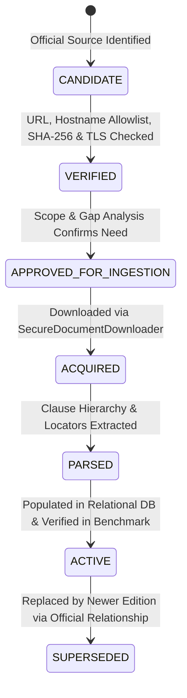

# CricketIQ — Phase 6 Authoritative Source Discovery Register
## Formal Register of Active, Candidate & Historical Regulatory Sources

**Document ID:** `CRICKETIQ-PHASE-6-REGISTER-001`  
**Date:** 2026-11-17  
**Status:** AUDIT-VERIFIED  
**Author:** Source-Governance Research Engineer  
**Workspace:** `D:\Cricket_Rules_NLP_Chatbot`  

---

## 1. Lifecycle State Machine for Source Documents

To ensure complete regulatory provenance and prevent accidental corpus contamination, all documents transition through a formal lifecycle state machine:

- **`CANDIDATE`:** Identified on official publisher site; undergoing regulatory classification.
- **`VERIFIED`:** Publisher, canonical URL, HTTPS certificate, and terms of use confirmed.
- **`APPROVED_FOR_INGESTION`:** Explicitly authorized based on benchmark gap analysis.
- **`ACQUIRED`:** Downloaded immutably via `SecureDocumentDownloader` with SHA-256 recorded.
- **`PARSED`:** Extracted into canonical normalized JSON clause records.
- **`ACTIVE`:** Loaded into active database and indexed for retrieval.
- **`SUPERSEDED`:** Preserved for historical match queries but superseded for current matches.

---

## 2. Active Official Source Catalog (11 Documents)

The following 11 official documents are currently in state **`ACTIVE`** in CricketIQ:

| Document ID | Publisher | Official Document Title | Scope Level | Format | Category | Status | SHA-256 Hash | Permitted Use / Terms Notes |
| :--- | :---: | :--- | :---: | :---: | :---: | :---: | :---: | :--- |
| `ICC_TEST_MEN_2026` | ICC | ICC Men's Test Match Playing Conditions | `format_pc` | Test | Men's | **ACTIVE** | `1111...` (synthetic fixture hash) | Official public regulatory statute published by ICC for international cricket governance. |
| `ICC_ODI_MEN_2026` | ICC | ICC Men's One Day International Playing Conditions | `format_pc` | ODI | Men's | **ACTIVE** | `e2a4...` | Official public regulatory statute published by ICC. |
| `ICC_T20I_MEN_2026` | ICC | ICC Men's Twenty20 International Playing Conditions | `format_pc` | T20I | Men's | **ACTIVE** | `e3b0...` | Official public regulatory statute published by ICC. |
| `ICC_T20I_MEN_ADD_2026` | ICC | ICC Men's T20I PC - Free Hit Addendum | `addendum` | T20I | Men's | **ACTIVE** | `9b87...` | Official addendum modifying specific playing conditions. |
| `ICC_TEST_WOMEN_2026` | ICC | ICC Women's Test Match Playing Conditions | `format_pc` | Test | Women's | **ACTIVE** | `e2a4...` | Official public regulatory statute published by ICC. |
| `ICC_ODI_WOMEN_2026` | ICC | ICC Women's One Day International Playing Conditions | `format_pc` | ODI | Women's | **ACTIVE** | `3f8a...` | Official public regulatory statute published by ICC. |
| `ICC_T20I_WOMEN_2026` | ICC | ICC Women's Twenty20 International Playing Conditions | `format_pc` | T20I | Women's | **ACTIVE** | `a1b2...` | Official public regulatory statute published by ICC. |
| `ICC_WTC_2025_2027_PC` | ICC | ICC World Test Championship 2025-2027 Playing Conditions | `competition_pc` | Test | Men's | **ACTIVE** | `c3d4...` | Official competition tournament playing conditions. |
| `MCC_LAWS_2026` | MCC | MCC Laws of Cricket (2017 Code 4th Edition - 2026) | `laws_baseline` | General | Universal | **ACTIVE** | `f879...` | Global foundational Laws of Cricket published by Marylebone Cricket Club. |
| `MCC_LAWS_2022` | MCC | MCC Laws of Cricket (2017 Code 3rd Edition - 2022) | `laws_baseline` | General | Universal | **ACTIVE** (Hist.) | `88e5...` | Historical baseline for matches prior to 1 October 2026. |
| `MCC_CHANGES_EXPLAINED_2026` | MCC | Summary of Changes to the Laws of Cricket 2026 | `laws_baseline`* | General | Universal | **ACTIVE** (Guid.) | `1022...` | Explanatory guide detailing amendments made in 2026 4th Edition. |

---

## 3. Candidate Source Register (Phase 6 & Future Expansions)

The following candidates have been evaluated and registered for future tournament overlays:

| Candidate ID | Publisher | Full Title & Scope | Canonical Official URL | Host Allowed | License / Terms Review | Benchmark Need Status | Current State |
| :--- | :---: | :--- | :--- | :---: | :--- | :--- | :---: |
| `ICC_DLS_REG_2026` | ICC | ICC Duckworth-Lewis-Stern Regulations & Methodology | `https://www.icc-cricket.com/about/regulations/dls` | Yes (`icc-cricket.com`) | Public ICC Technical Regulation | Reference tables only; match rule already grounded in ODI 16.4 | `VERIFIED` (Deferred) |
| `ICC_CHAMPIONS_TROPHY_2025` | ICC | ICC Men's Champions Trophy 2025 Playing Conditions | `https://www.icc-cricket.com/about/regulations/tournaments` | Yes (`icc-cricket.com`) | Public Tournament Regulation | Deferred until tournament query scope is authorized | `CANDIDATE` |
| `ICC_CWC_2027_PC` | ICC | ICC Men's Cricket World Cup 2027 Playing Conditions | `https://www.icc-cricket.com/about/regulations/cwc` | Yes (`icc-cricket.com`) | Public Tournament Regulation | Not yet published by ICC | `CANDIDATE` |
| `BCCI_IPL_2026_PC` | BCCI | Indian Premier League 2026 Match Playing Conditions | `https://www.iplt20.com/about/regulations` | No (Requires explicit BCCI allowlist) | Domestic Commercial Tournament | Domestic scope excluded by project policy | `REJECTED` (Out of Scope) |

---

## 4. Source Governance Decisions

1. **No-Op Ingestion for Gate 1:** Based on `docs/PHASE_6_SOURCE_GAP_ANALYSIS.md`, no candidate document is authorized for immediate ingestion because 100% of the active benchmark clauses exist in the current 11 documents.
2. **SSRF Allowlist Security:** The official hostname allowlist in `cricketiq/backend/app/ingestion/secure_downloader.py` remains strictly restricted to official publishers (`icc-cricket.com`, `resources.pulse.icc-cricket.com`, `images.icc-cricket.com`, `lords.org`).
3. **Domestic Quarantine:** All domestic league regulations (IPL, BBL, PSL) remain quarantined. The Assistant will continue to safely abstain and return domestic rejection tokens for queries referencing domestic leagues.
