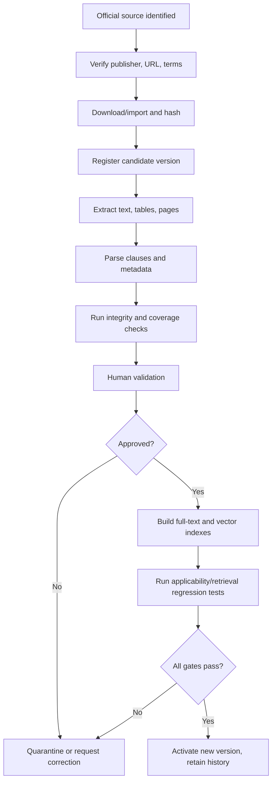

# Rule Data Governance — CricketIQ

## 1. Purpose

This document defines how CricketIQ acquires, stores, versions, validates, and applies cricket regulations. It is a core correctness specification: a technically strong RAG pipeline is unsafe if it retrieves the wrong edition or loses the exceptions around a clause.

## 2. Source policy

### Authoritative source categories

1. **MCC Laws of Cricket:** baseline Laws of the game.
2. **ICC Playing Conditions:** international format-specific playing conditions that may supplement or modify the Laws.
3. **Competition-specific regulations and addendums:** apply only to the named competition and stated context.
4. **Official amendments/notices:** link to the document version and applicability conditions they amend.

Secondary websites, articles, FAQs, commentary, and forum posts may help discover a question or terminology, but must not be treated as authoritative rule evidence.

### Required source checks

For every candidate source, record:

- Official publisher and document title.
- Official source URL and retrieval timestamp.
- File format, size, and SHA-256 hash.
- Edition/version and publication date (if stated).
- Effective date or applicability wording (if stated).
- Format, gender/category, competition, and geographic/organizational scope.
- Amendment/supersession relationships.
- Terms of use, copyright, permitted storage, quotation, and redistribution notes.
- Ingestion status and reviewer identity/status.

Do not activate a source if publisher authenticity, version identity, or required applicability metadata is unresolved.

## 3. Rule applicability model

A rule candidate depends on:
- Governing source and document type (`Law`, `Playing Conditions`, `Competition Regulations`, `Addendum`).
- Format: `Test`, `ODI`, `T20I`, or `General`.
- Category: `Men's`, `Women's`, or `Universal`.
- Competition/tournament: e.g. `T20_WORLD_CUP_2026`, `WTC`, or standard international.
- Date trigger basis:
  - `series_start_date`: Governs ICC Playing Conditions transitions. Under ICC regulations, updated playing conditions (such as the 1 October 2026 changes) apply to international series starting on or after that date. Ongoing series that started before continue under previous regulations.
  - `match_date`: Specific day of play. Cannot alone resolve an ICC transition when series start date is ambiguous.
  - `competition_start_date`: Governs tournament-specific regulations.
  - `season_edition`: Governs general MCC Laws editions.
- Explicit relationships: `incorporates`, `modifies`, `supplements`, and `supersedes`.

**No Simplistic Universal Precedence:** ICC Playing Conditions modify MCC Laws only where explicit modifying language or clause relationships exist. Precedence order in an assembled Source Bundle is:
$$\text{Competition Regulations} \longrightarrow \text{Addenda} \longrightarrow \text{Format Playing Conditions} \longrightarrow \text{MCC Laws Baseline}$$

## 3.1 Dependency Licensing Audit & Compliance
- **PyMuPDF (`fitz`):** Licensed under GNU AGPL v3 / Commercial.
  - *Compliance Position:* For open-source and local development, CricketIQ complies with AGPL v3 by making full corresponding source code transparent and verifiable. For commercial distributions with proprietary hosting, CricketIQ isolates PDF extraction behind an adapter interface (`PDFExtractor`) that allows seamless substitution with Apache-2.0/MIT parsers (`pdfplumber` / `pypdfium2`).
- **pdfplumber:** MIT License.
- **SQLAlchemy & Pydantic:** MIT License.
- **Alembic:** MIT License.

## 4. Suggested relational schema

The schema is conceptual; inspect the current database before creating migrations.

### `source_documents`

| Field | Meaning |
|---|---|
| `id` | Stable internal document ID |
| `publisher` | MCC, ICC, or named competition authority |
| `title` | Official document title |
| `document_type` | Law, playing conditions, competition regulation, amendment |
| `format` | Test, ODI, T20I, or null if general |
| `category` | Source-defined category, e.g. men's/women's |
| `competition` | Competition identifier or null |
| `edition` | Edition/version label exactly as published |
| `published_at` | Publication date, when stated |
| `effective_from` | Effective date, when stated |
| `effective_until` | End date, if explicitly known |
| `official_url` | Canonical official URL |
| `retrieved_at` | Ingestion retrieval timestamp |
| `sha256` | File integrity hash |
| `status` | Candidate, processing, review, active, superseded, archived, rejected |
| `terms_notes` | Internal license/usage review note |

### `rule_clauses`

| Field | Meaning |
|---|---|
| `id` | Stable internal clause ID |
| `source_document_id` | Owning document |
| `clause_number` | Original clause identifier |
| `parent_clause_id` | Parent heading/clause |
| `heading` | Original heading |
| `original_text` | Extracted original clause text |
| `normalized_text` | Search-friendly normalized text; never replaces original |
| `page_start` / `page_end` | PDF page mapping |
| `source_locator` | Stable URL fragment or internal source location |
| `clause_type` | Rule, definition, exception, procedure, table, note |
| `cross_references` | Related clause identifiers |
| `validation_status` | Unchecked, validated, corrected, rejected |

### `document_relationships`

Represent amendment, correction, replacement, supersession, incorporation, and explicit reference relationships. Store the source clause/section that supports the relationship when available.

### `rule_embeddings`

Store embedding model/version, source clause ID, chunk/context strategy version, vector, and creation timestamp. Rebuildable derived data; do not use the embedding row as the source of truth.

## 5. Chunking and extraction rules

- Prefer clause-aware segmentation over arbitrary fixed-character chunks.
- Keep each clause connected to its parent heading and document identity.
- Preserve numbered subclauses and lists in their original order.
- Include table title, headers, row/column relationships, and page mapping when extracting tables.
- Do not merge unrelated clauses merely to reach a target token count.
- For long clauses, split only at logical boundaries and retain a shared parent-clause ID.
- Store extraction confidence/diagnostics and flag suspiciously short, empty, or garbled pages.
- OCR is a fallback for scanned pages; label OCR-derived text and require review for critical content.
- Preserve a link from every normalized record back to the original PDF page/region where possible.

## 6. Validation gates before activation

A candidate document can become active only after:

1. Official publisher and source URL checked.
2. File hash recorded and duplicate/version check completed.
3. Edition, scope, and effective/applicability wording captured or explicitly marked unknown.
4. Text extraction coverage checked; tables and clause numbering sampled.
5. Clause hierarchy and page references validated.
6. Relevant amendments and superseded documents linked.
7. Licensing/usage notes reviewed.
8. Human reviewer approves the source for the intended corpus scope.
9. Ingestion and retrieval regression tests pass.

Keep old active versions available for historical queries. Activation must not delete prior versions.

## 7. Ingestion workflow

## 8. Current-edition seed note

The initial source collection should verify the MCC 2026 Code (fourth edition) and the ICC playing-condition documents published for October 2026. ICC's published update states that its October 2026 changes apply to series starting on or after 1 October 2026, while ongoing series continue under their previous regulations. Treat this as a source-specific applicability statement to encode and test—not as a universal date rule for every regulation. Verify the exact document text and official updates before implementation.

## 9. Data quality and governance operations

- Re-check official source directories on a controlled schedule and when a known amendment is announced.
- Compare new file hashes and extracted clause text to prior editions.
- Produce a human-readable change report at clause level.
- Require reviewer approval for activation of new or corrected documents.
- Keep ingestion logs, parser versions, and validation reports.
- Rebuild embeddings after changes to validated source text or embedding model; preserve model/version lineage.
- Record a rollback procedure that reactivates the prior validated index without deleting the new candidate.
