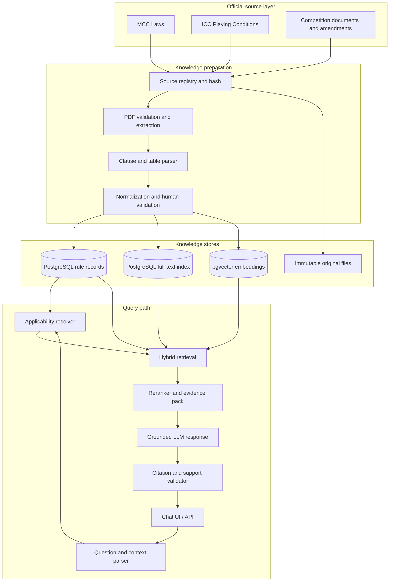

# System Architecture — CricketIQ

## 1. Architecture principles

1. **Evidence first:** generated answers are downstream of source retrieval and validation.
2. **Version-aware:** a rule is not just text; it belongs to a document edition and applicability context.
3. **Clause-preserving:** retain original clause structure, hierarchy, page/source location, and cross-references.
4. **Deterministic where possible:** document status, metadata filters, and applicability selection are application logic, not free-form LLM decisions.
5. **Replaceable providers:** avoid vendor-specific logic in the domain layer.
6. **Incremental delivery:** build and validate one vertical slice before adding advanced features.

## 2. Logical architecture

## 3. Recommended MVP technology choices

These are defaults to validate against the existing repository and budget—not mandatory dependencies.

| Layer | Initial choice | Rationale |
|---|---|---|
| Language | Python | Mature PDF, NLP, and retrieval ecosystem |
| API | FastAPI | Typed HTTP API and straightforward testing |
| UI | Streamlit for prototype; consider Next.js for production | Fast MVP, then richer product UI if justified |
| Structured storage | PostgreSQL | Documents, clauses, metadata, feedback, and audit trail |
| Vector retrieval | pgvector | Keep semantic retrieval close to the source records |
| Keyword retrieval | PostgreSQL full-text search | Exact clause terms and phrase matching |
| PDF extraction | PyMuPDF; evaluate Docling for layout-heavy files | Preserve page and layout information |
| Embeddings | Provider adapter with an evaluated embedding model | Keep model choice replaceable |
| Generation | LLM provider adapter | Support hosted or local models without coupling domain logic |
| Tests | pytest plus retrieval/answer evaluation harness | Unit, integration, and benchmark tests |
| Packaging | Docker when deployment needs it | Repeatable local and hosted runtime |

Do not add a separate vector database, cache, queue, or orchestration framework until measured needs justify it.

## 4. Core bounded contexts / modules

### 4.1 Source Registry

Responsibilities: source identity, publisher, document URL, file hash, edition, publication and effective dates, status, retrieval date, license/terms notes, and amendment relationships.

### 4.2 Ingestion and Extraction

Responsibilities: download/import, file validation, duplicate detection, text/layout extraction, table extraction, page mapping, parser diagnostics, and quarantine of malformed or untrusted files.

### 4.3 Rule Normalization

Responsibilities: represent laws, playing-condition clauses, definitions, subclauses, tables, exceptions, and cross-references without losing original source text. Normalization must not silently alter meaning.

### 4.4 Applicability Engine

Responsibilities: determine candidate documents using format, category, competition, match/series context, and explicit effective-date/precedence statements. Return a structured decision with reasons and unresolved conditions.

### 4.5 Retrieval Engine

Responsibilities: query expansion where helpful, metadata-filtered BM25/full-text search, semantic retrieval, result fusion, reranking, and assembly of parent/child/exception context.

### 4.6 Answer Generation

Responsibilities: build an evidence-bounded prompt, generate explanation, distinguish source text from interpretation, include citations, and abstain when evidence is insufficient.

### 4.7 Citation/Support Validator

Responsibilities: verify cited source IDs and clause IDs exist, ensure citations are among retrieved evidence, detect uncited high-impact claims where feasible, and reject malformed references.

### 4.8 User Interface and API

Responsibilities: ask questions, collect context, show answers and sources, allow correction of context, show comparison results, and collect quality feedback.

## 5. Query sequence

1. Validate request and load conversation context.
2. Extract intent and explicit entities: format, competition, category, dates, event details, and clause references.
3. Mark inferred context separately from user-provided context.
4. Ask a clarification if a missing value could change the applicable regulation and cannot be safely bounded.
5. Call the applicability engine to return candidate source editions and filtering constraints.
6. Run full-text and vector retrieval within the allowed source set; include clause hierarchy and exceptions.
7. Fuse and rerank results. Keep provenance on every evidence item.
8. Build a compact evidence pack with source IDs, full clause text, parent context, and relevant cross-references.
9. Generate an answer constrained to the evidence pack.
10. Validate citations and support. If validation fails, repair once or abstain.
11. Return answer, context assumptions, citations, and trace metadata.

## 6. Data flow and key boundaries

- The raw official file is immutable after registration; a replacement edition is a new record.
- Extracted text and normalized metadata are separate representations.
- Embeddings are derived artifacts and can be rebuilt from validated clause records.
- Query-time retrieval must filter by applicability before or during candidate selection—not merely ask the LLM to choose the right format from a mixed corpus.
- The answer generator cannot create source records or mark documents authoritative.
- Admin ingestion and source activation are separate from normal chat endpoints.

## 7. Initial API sketch

These are conceptual contracts; confirm naming and framework conventions during implementation.

- `POST /api/chat` — question plus optional match context; returns answer, citations, assumptions, and trace ID.
- `POST /api/rules/search` — structured rule search for internal/debug use.
- `GET /api/sources` — list active and archived source metadata according to access policy.
- `POST /api/admin/sources` — register an official source (protected).
- `POST /api/admin/sources/{id}/ingest` — run extraction and validation (protected).
- `POST /api/admin/sources/{id}/activate` — activate only after required checks (protected, approval-gated).
- `POST /api/feedback` — report answer/citation quality issue.

## 8. Decisions to record as ADRs

Record a short Architecture Decision Record when deciding:

- Which source types and competitions enter the MVP corpus.
- How applicability and precedence are represented.
- Which embedding model and LLM provider are selected and why.
- How retrieval scores are fused and calibrated.
- Which UI framework is retained beyond prototype.
- How source licensing and document storage are handled.

Each ADR should contain context, decision, alternatives, consequences, and date. Do not present proposed choices as implemented facts.
