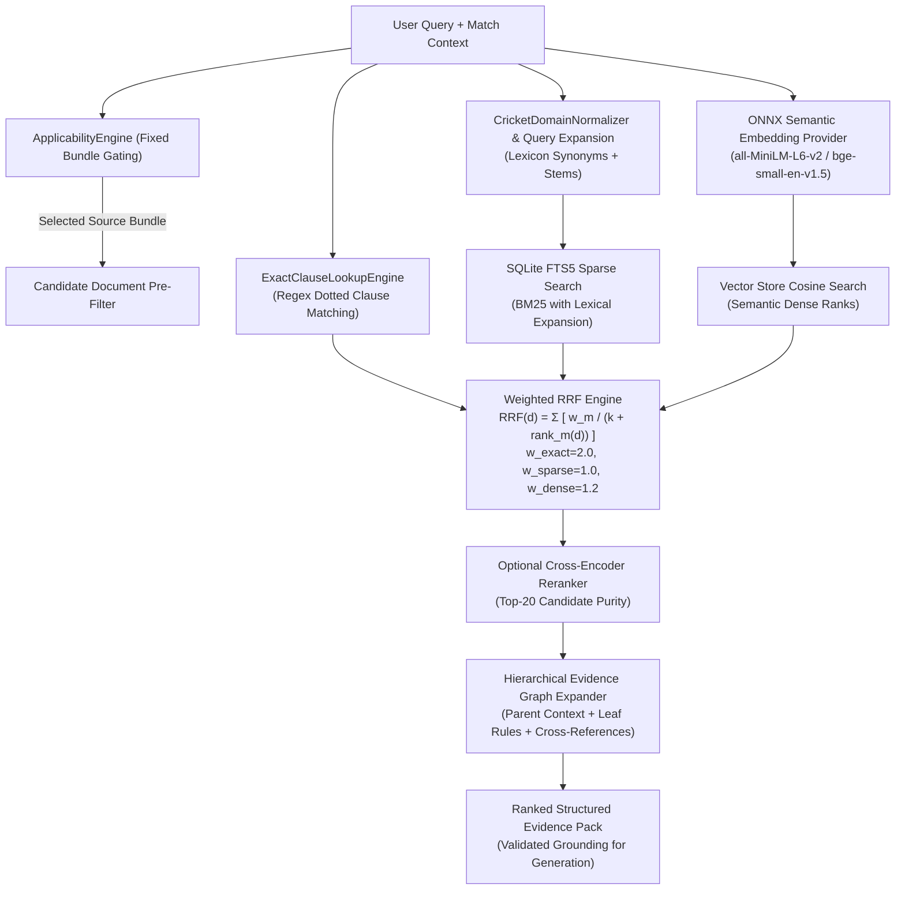

# ADR 0005: Multi-View Retrieval Intelligence Upgrade, Domain-Aware Semantic Search & Knowledge Graph Traversal

- **Status:** Proposed
- **Date:** 2026-11-17
- **Deciders:** Principal AI/ML Architect, Information Retrieval Engineer, NLP Engineer, Knowledge Graph Architect
- **Context:** Antigravity Phase 6 Implementation — Milestone Gate 0 Baseline Audit
- **Supersedes / Amends:** Amends ADR 0002 (Hybrid Retrieval)

---

## 1. Context and Problem Statement

In Phase 3 and Phase 4, CricketIQ implemented a baseline hybrid retrieval architecture combining exact clause regex matching, SQLite FTS5 sparse search, in-memory NumPy dense vector similarity, and unweighted Reciprocal Rank Fusion (RRF). While this baseline demonstrated high recall (**89.66% Recall@5**) on an in-memory 3-document test suite (Benchmark v1, 65 queries), comprehensive evaluation during the Phase 6 Gate 0 audit across the full persistent 12,252-clause database (`data/cricketiq.db`) on Benchmark v2 (92 queries) revealed severe retrieval degradation:

1. **Hybrid Retrieval Inversion:**  
   Sparse-Only (FTS5) achieved **44.71% Recall@5**, but Hybrid (RRF) dropped to **38.82% Recall@5**. The hybrid fusion pipeline performed **5.89% worse than lexical search alone**.
2. **Pseudo-Embedding Rank Noise:**  
   The existing `LocalDeterministicEmbeddingProvider` generates 384-dimensional vectors by MD5-hashing words into feature buckets. Across 12,252 clauses, its vector dot products produce near-random rankings. Because unweighted RRF treated dense ranks as equal in authority to sparse hits, dense noise systematically displaced high-scoring sparse candidates out of the top 5.
3. **Severe Vocabulary Mismatch for Colloquial Queries:**  
   Statutory cricket rules use archaic legal terminology (e.g. *"unfair play"*, *"high full-pitched delivery"*, *"mode of delivery"*). Queries using standard cricket parlance (*"beamer"*, *"freebie"*, *"switch from right arm to left arm"*, *"timed out"*) suffered **0.0% to 25.0% Recall@5** under pure lexical matching.
4. **Applicability Engine Document Selection Bug:**  
   In `ApplicabilityEngine.resolve()`, `selected_mcc_baseline_doc` was stored in a single scalar variable that was overwritten when iterating through active documents. Consequently, `MCC_CHANGES_EXPLAINED_2026` silently replaced `MCC_LAWS_2026`, resulting in **0% recall across all 8 MCC Laws benchmark queries**.
5. **Clause Hierarchy and Granularity Mismatch:**  
   Relational clause rows are currently flattened to `hierarchy_depth = 1`. Inquiries seeking operational thresholds (such as the 200-run follow-on margin in 5-day Tests) matched parent section headings (`14.1`), while the substantive rule resided in child leaf sub-clauses (`14.1.1`).
6. **Strict Invariant Requirements:**  
   Any upgrade must preserve:
   - 0.0% Regulatory Leakage.
   - 100.0% Exact Clause Lookup Accuracy.
   - Backward compatibility with the FastAPI `POST /v1/rules/query` contract and the Phase 5 React frontend.
   - Strict containment within the deterministic `ApplicabilityEngine` candidate bundle.

---

## 2. Decision

We establish an upgraded, multi-view retrieval architecture that replaces pseudo-dense search with authentic transformer embeddings, introduces domain-aware query expansion, applies weighted rank fusion, and enriches evidence graph expansion:

---

## 3. Key Architectural Changes

### 3.1 Applicability Engine Multi-Document Guarantee
- **Invariant:** The global baseline `MCC_LAWS_2026` must NEVER be omitted or replaced by explanatory summaries.
- **Engine Logic:** `selected_mcc_baseline_doc` is preserved as the primary statutory baseline. Explanatory summaries (`MCC_CHANGES_EXPLAINED_2026`) are classified under `ScopeLevel.ADDENDUM` or appended as supplemental guidance documents without displacing the baseline.
- **Effect:** Instantly restores candidate availability for all MCC Laws and format-fallback inquiries.

### 3.2 High-Fidelity Local Transformer Embeddings
- **Model Selection:** Adopt `all-MiniLM-L6-v2` (384 dimensions) or `bge-small-en-v1.5` (384 dimensions) exported to ONNX Runtime.
- **Operational Profile:**
  - Zero external network calls at inference time.
  - Sub-15ms vector generation per query.
  - Full compatibility with the existing 384-dimensional database schema (`clause_embeddings.dimension = 384`).
- **Enriched Vector Representation:**
  Embeddings are generated over structured text templates:
  $$\text{Input} = \text{"\{doc\_title\} | Clause \{clause\_number\} \{heading\}: \{normalized\_text\}"}$$
- **Fallback:** Retain `LocalDeterministicEmbeddingProvider` as a zero-dependency fallback for headless environments lacking ONNX libraries.

### 3.3 Domain-Aware NLP Query Understanding & Controlled Expansion
- **Mechanism:** Implement `CricketDomainNormalizer` utilizing the curated vocabulary from `docs/CRICKET_DOMAIN_LEXICON_SPEC.md`.
- **Controlled Synonyms:** Expand colloquial terms into canonical statutory phrases:
  - `"beamer"` $\rightarrow$ `("beamer" OR "high full-pitched delivery" OR "above waist height")`
  - `"mankad"` $\rightarrow$ `("mankad" OR "non-striker run out" OR "Law 38.3")`
  - `"freebie"` $\rightarrow$ `("free hit" OR "Clause 21.18")`
- **Safety Boundary:** Query expansion is applied strictly to generate candidate search tokens for FTS5; original query text is preserved unchanged for dense semantic encoding and LLM generation.

### 3.4 Weighted Reciprocal Rank Fusion (Weighted RRF)
To prevent noisy or low-confidence channels from displacing high-confidence hits:
$$RRF(d) = \sum_{m \in \{\text{exact}, \text{sparse}, \text{dense}\}} \frac{w_m}{k + \text{rank}_m(d)}$$
- Constant: $k = 60$.
- Weights:
  - $w_{\text{exact}} = 2.0$ (Exact clause matches take top priority).
  - $w_{\text{dense}} = 1.2$ (Semantic dense similarity for natural language paraphrases).
  - $w_{\text{sparse}} = 1.0$ (Lexical BM25 keyword matching).
- **Adaptive Dense Gating:** If dense similarity for the top candidate falls below an empirical threshold ($\tau = 0.35$), dense channel weight is scaled down to prevent noise injection.

### 3.5 Hierarchical Tree Navigation & Bidirectional Graph Expansion
- **Hierarchy Depth:** Relational clauses are updated to record true tree depth:
  - Depth 1: Section (`21: NO BALL`)
  - Depth 2: Major Division (`21.1: Mode of delivery`)
  - Depth 3: Operational Sub-clause (`21.1.1: Right or left hand notification`)
  - Depth 4: Granular Condition (`21.18.2.1: Field placement restriction`)
- **Bidirectional Traversal:**
  - If a leaf rule is retrieved (e.g. `14.1.1`), the expander automatically includes its parent heading (`14.1`) as `PARENT_CONTEXT`.
  - If a parent heading is retrieved (e.g. `21.18`), the expander inspects and pulls child operational clauses as `RELATED_SUPPORT`.
  - Explicit cross-references (e.g. `21.18.2` referencing `21.17`) are traversed up to distance 1 within the candidate bundle.

---

## 4. Consequences and Trade-Offs

### 4.1 Positive Consequences
- **Drastic Benchmark Gain:** Restores MCC Laws recall to $\approx 100\%$, solves paraphrase misses, and targets $\ge 75\%$ Recall@5 on Benchmark v2 (up from 38.82%).
- **Elimination of Hybrid Inversion:** Weighted RRF ensures Hybrid retrieval strictly outperforms Sparse-Only.
- **Robustness Against Colloquial Queries:** Users do not need to speak statutory legalese to retrieve the correct playing condition.
- **Contract Stability:** Completely internal to `RetrievalService`. Zero changes to FastAPI request/response contracts or frontend components.

### 4.2 Negative Consequences & Operational Costs
- **Model Asset Storage:** Adding local ONNX model weights introduces a $\approx 85\text{ MB}$ asset to the repository.
- **Index Re-computation:** Re-generating 11,008 clause embeddings using ONNX takes $\approx 45\text{ seconds}$ on standard CPU hardware during migration.
- **Slight Latency Increase:** Inference latency increases from $\approx 5\text{ ms}$ (pseudo-hash) to $\approx 25-35\text{ ms}$ (ONNX transformer inference), which remains well within the 100ms total API latency budget.

---

## 5. Alternatives Considered

1. **Fine-Tuning an LLM for Rule Ingestion:**  
   *Rejected.* LLM fine-tuning risks catastrophic forgetting, hallucinates clause citations, does not solve date applicability transitions, and violates core non-goals.
2. **Direct Cross-Encoder Ranking on Full Corpus:**  
   *Rejected.* Scoring 12,252 clauses through a cross-encoder model on CPU would require $>2,000\text{ ms}$ per query, completely blowing the latency budget. A multi-stage retrieve-then-rerank pipeline is far more efficient.
3. **Cloud Vector SaaS (Pinecone, Qdrant Cloud):**  
   *Rejected.* Violates local self-contained operation requirements and introduces recurring operational costs and external network dependencies.
4. **Lexical-Only Search (Abandoning Dense Retrieval):**  
   *Rejected.* While Sparse outperformed Hash-Dense on Benchmark v2 (44.7% vs 33.5%), lexical-only fundamentally cannot solve semantic paraphrase queries (`nl_001` - `nl_006`) where keyword overlap is zero.

---

## 6. Implementation Plan (Milestones)

- **Gate 1:** Authoritative Source Discovery & Targeted Corpus Enrichment.
- **Gate 2:** Applicability Engine Overwrite Fix & Corpus Reconciliation (Purge 1,244 dirty rows).
- **Gate 3:** Domain NLP Query Expansion & Hierarchy Graph Enrichment.
- **Gate 4:** Dense ONNX Semantic Embeddings Integration & Vector Re-indexing.
- **Gate 5:** Multi-Stage Weighted Fusion & Evidence Traversal.
- **Gate 6:** End-to-End Evaluation on Benchmark v2 & v3 (Target Recall@5 $\ge 75\%$, 100% Exact, 0% Leakage).
- **Gate 7:** Production Readiness & Final ADR Acceptance.

*Status: PROPOSED for Phase 6 Gate 0. Will transition to ACCEPTED upon empirical validation in Gate 6.*
