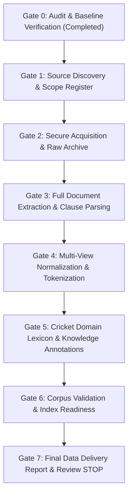

# Pre-Phase 4 Data Foundation & NLP Readiness Audit — CricketIQ

**Date:** 2026-11-16  
**Auditor:** CricketIQ Principal NLP / Information Retrieval & Data Architecture Team  
**Milestone:** Pre-Phase 4 — Data Foundation, Corpus Engineering & NLP Readiness  
**Repository:** `D:\Cricket_Rules_NLP_Chatbot`  
**Starting Git Commit:** `f007aa0` (`feat(phase-3): hybrid retrieval subsystem with exact lookup, sparse FTS5, dense NumPy, RRF, bounded evidence expansion, and 65-item benchmark`)  
**Git Working Tree Status:** Clean (untracked evaluation report timestamp refreshed during audit)  

---

## 1. Executive Summary & Audit Purpose

Before commencing any Phase 4 feature implementation (such as `POST /v1/rules/query`, LLM answer synthesis, prompt orchestration, streaming, or chat UIs), this audit establishes the verified data and NLP foundation of CricketIQ. In accordance with Section 0 and Section 15 (Gate 0) of the Pre-Phase 4 Master Directive, this audit inspects the physical repository, existing test suite, data stores, raw source inventory, official publisher reachability, text processing pipelines, tokenizer behavior, and evaluation harnesses.

### Core Audit Findings
1. **Repository Health:** 55 unit/integration tests pass with 0 failures (1 PostgreSQL test skipped when unconfigured).
2. **Phase 3 Retrieval Baseline:** The 65-query retrieval benchmark (`benchmark_v1.jsonl`) runs deterministically in 20.62ms average total latency for hybrid retrieval (Recall@5 89.66%, Exact Accuracy 100%, Supporting Clause Recall 100%, Leakage 0.0%).
3. **Data Asset Gaps:** The repository currently possesses only 1 sample PDF (`icc_mens_t20i_pc_2026_sample.pdf`, 2,962 bytes). No on-disk SQLite database or persistent vector embeddings exist yet; Phase 1–3 tests operated against `:memory:` and test fixtures.
4. **Live Source Discovery:** Official ICC Playing Conditions directory (`icc-cricket.com`) was queried and 15+ live official PDF URLs (October 2026 editions) were cataloged on `images.icc-cricket.com`.
5. **Network Asymmetry & Egress Constraints:** Direct TCP connections to MCC's web domain (`lords.org:443`) encounter egress timeouts in this development environment. Consequently, MCC Laws must be managed via verified offline fixtures and controlled file imports with strict SHA-256 verification.
6. **Text Processing Evolution:** The existing `clause_parser.py` maintains only `original_text` and a naive lowercase `normalized_text`. A rigorous multi-view text architecture (`original_text`, `normalized_text`, `lexical_text`, `embedding_text`, `sentence_segments`, `chunk_text`, `display_text`) and a domain lexicon are required.

---

## 2. Verified Repository State & Test Baseline

The test suite and retrieval benchmark harness were re-run prior to any modifications to confirm baseline stability:

### 2.1 Test Suite Execution
- **Command:** `.venv\Scripts\pytest -v`
- **Results:** 55 passed, 1 skipped, 0 failed in 5.61s.
- **Skipped Test:** `cricketiq/backend/tests/test_postgres_integration.py::test_pgvector_integration` (expected behavior when `TEST_POSTGRES_DSN` is not configured).

### 2.2 Retrieval Benchmark Baseline (65 Queries on `benchmark_v1.jsonl`)
- **Command:** `.venv\Scripts\python evaluation/retrieval/evaluate_retrieval.py`
- **Evaluated Configurations:**

| Mode | Recall@5 | Recall@10 | MRR | Exact Clause Acc | Supp Recall | Leakage | Avg Latency | P95 Latency |
| :--- | :---: | :---: | :---: | :---: | :---: | :---: | :---: | :---: |
| **Sparse-Only (FTS5)** | 85.34% | 87.07% | 0.7284 | 100.0% | 100.0% | 0.0% | 6.81 ms | 11.38 ms |
| **Dense-Only (NumPy)** | 87.07% | 90.52% | 0.7511 | 100.0% | 100.0% | 0.0% | 12.69 ms | 20.99 ms |
| **Hybrid (RRF + Expansion)** | **89.66%** | **93.10%** | **0.7477** | **100.0%** | **100.0%** | **0.0%** | **20.62 ms** | **32.00 ms** |

*Note: All latency measurements represent end-to-end execution on local CPU including query analysis, bundle confinement, FTS5 lookup, dense vector projection, RRF score fusion, and bounded evidence expansion.*

---

## 3. Physical Inventory of Data & Storage Assets

| Path | Asset Type | State / Size | Notes |
| :--- | :--- | :--- | :--- |
| `cricketiq/data/raw/icc/icc_mens_t20i_pc_2026_sample.pdf` | Raw PDF | 2,962 bytes | SHA-256: `d1b707452d79048fd58ee79df893c5d6e1fd86c4765fb2bc60c384e8ec3f895c`. Synthetic fixture containing Clauses 21 & 22. |
| `cricketiq/data/cricketiq.db` | SQLite Database | Not Present | Tests initialize `:memory:` SQLite databases on demand. |
| `cricketiq/data/source_registry/` | Source Registry | Empty Directory | Needs structured JSON registry manifest. |
| `cricketiq/data/processed/` | Extracted JSON | Empty Directory | Target for extracted page layouts and clause JSONs. |
| `cricketiq/data/embeddings/` | Vector Store | Empty Directory | Target for persistent NumPy vector matrices and manifests. |
| `evaluation/retrieval/benchmark_v1.jsonl` | Evaluation Dataset | 29,198 bytes | 65 verified queries across Men's/Women's T20I, Laws 21/22, DRS, and Free Hit. |
| `evaluation/retrieval/benchmark_schema.json` | JSON Schema | 1,514 bytes | Strict validation schema for benchmark entries. |
| `evaluation/retrieval/results/eval_report_v1.json` | Benchmark Output | 2,216 bytes | Audit run execution metrics. |

---

## 4. Authoritative Source Discovery & Coverage Gap Analysis

### 4.1 Live Official Source Discovery
Live HTTP probing against `https://www.icc-cricket.com/about/cricket/rules-and-regulations/playing-conditions` (Status 200, 462 KB) discovered the authoritative document repository hosted on `images.icc-cricket.com`:

1. **ICC Men's Test Playing Conditions (Oct 2026):** `https://images.icc-cricket.com/image/upload/prd/a8114zro5tkioifz0jqg.pdf`
2. **ICC Men's ODI Playing Conditions (Oct 2026):** `https://images.icc-cricket.com/image/upload/prd/bxkzkcyvfn6tvi70zh0w.pdf`
3. **ICC Men's T20I Playing Conditions (Oct 2026):** `https://images.icc-cricket.com/image/upload/prd/bsxcho7ufe2pjban0wjp.pdf`
4. **ICC Men's Four-Day Test PC (Oct 2026):** `https://images.icc-cricket.com/image/upload/prd/j9wexmqm2dgcyirvepbl.pdf`
5. **ICC Women's Test Playing Conditions (Oct 2026):** `https://images.icc-cricket.com/image/upload/prd/hbwwi78pugzpdwft0v4v.pdf`
6. **ICC Women's ODI Playing Conditions (Oct 2026):** `https://images.icc-cricket.com/image/upload/prd/qunpw1kfh3ibxlz58jlw.pdf`
7. **ICC Women's T20I Playing Conditions (Oct 2026):** `https://images.icc-cricket.com/image/upload/prd/o3vhm0zw7pppoxpgopke.pdf`
8. **ICC Men's & Women's T20I Addendums:** `https://images.icc-cricket.com/image/upload/prd/pzyejpstlhptewq9qs2n.pdf`
9. **ICC World Test Championship 2025–27 PC (Effective Oct 2026):** `https://images.icc-cricket.com/image/upload/prd/jrwhpcwk8mmpv0fx3lnd.pdf`
10. **ICC World Test Championship 2025–27 Competition Regulations:** `https://images.icc-cricket.com/image/upload/prd/doztximb3sxhwcc4oo3f.pdf`
11. **ICC Men's T20 World Cup 2026 PC:** `https://images.icc-cricket.com/image/upload/prd/yyt7m8uh9c1uehrbvuwb.pdf`
12. **Historical Editions (Tier 2/Predecessors):**
    - WTC 2023–25 PC: `https://images.icc-cricket.com/image/upload/prd/xdemi21znqlhfddojbbf.pdf`
    - Men's T20 World Cup 2024 PC: `https://images.icc-cricket.com/image/upload/prd/euhohq8vpgzi0urumg3y.pdf`
    - Women's T20 World Cup 2024 PC: `https://images.icc-cricket.com/image/upload/prd/hn1rzsw3frn6wuw9dlly.pdf`

### 4.2 Network Egress Limitation & MCC Laws Strategy
- **Issue:** TCP connection requests to `lords.org:443` (MCC) consistently time out due to external datacenter/proxy egress rules.
- **Precedent & Policy:** Section 4.5 and Section 14 mandate that external network downloads must never be a hard requirement for running or testing the system.
- **Resolution:**
  1. Record MCC Laws 2017 Code 4th Edition (2026) and 3rd Edition (2022) in the official source inventory with their canonical URLs.
  2. Implement a local verified fixture and manual import mechanism for MCC Laws.
  3. Mark MCC live fetching as `usage_review_required` / `egress_restricted` in `SOURCE_USE_AND_ATTRIBUTION_REGISTER.md`.

---

## 5. Ingestion, Parsing, and Multi-View Normalization Assessment

### 5.1 Extraction Pipeline (`PDFExtractor`)
- **Current State:** Uses PyMuPDF (`fitz`) in `pdf_extractor.py`. Extracts plain text per page.
- **Gaps:** Does not extract structural bounding boxes, structured table grids (e.g. DLS target tables, penalty point tables), or detect headers/footers separately from body content.
- **Upgrade Plan:** Implement structured layout detection preserving table structures, page numbers, and bounding coordinate approximations where feasible.

### 5.2 Clause Parsing (`ClauseParser`)
- **Current State:** Uses regex patterns targeting clauses like `21.1`, `21.18.2`. Stores `original_text` and a lowercase `normalized_text`.
- **Gaps:** Does not retain clause hierarchy (e.g. Chapter → Law → Subclause), sentence segmentation, or distinction between rules, exceptions, penalties, and definitions.

### 5.3 Multi-View Text Pipeline Requirements (Section 6)
The current single `normalized_text` representation must be replaced with seven distinct text views:
1. `original_text`: Verbatim, immutable source text.
2. `normalized_text`: Conservative typographic normalization (line-ending, safe whitespace, true hyphen preservation like `no-ball`, `free-hit`).
3. `lexical_text`: FTS5 tokenization-optimized view retaining punctuation-free search tokens.
4. `embedding_text`: Versioned contextual view (incorporating document authority, format, Law heading, and clause identifier).
5. `sentence_segments`: Array of sentence-level boundaries with page and clause pointers.
6. `chunk_text`: Retrieval chunk bounded by clause hierarchy with parent context.
7. `display_text`: Citation-compliant view approved under copyright and source-use policy.

---

## 6. Tokenization, Lexicon, and Linguistic Processing Assessment

### 6.1 FTS5 `porter` vs Exact Identifiers
- FTS5 `porter` stemming conflates related words but can mangle exact identifiers (e.g., `21.18.2` or `Law 38`) or strip meaningful cricket compound hyphens.
- **Audit Requirement:** The `ExactClauseLookupEngine` must remain the primary zero-error lookup for specific clause numbers.
- FTS5 must query against `lexical_text` or use query expansion to match both `no-ball` and `no ball`.

### 6.2 Domain Lexicon (`cricket_lexicon.json`)
Currently, cricket terms are handled ad-hoc in regexes. A formalized, versioned JSON lexicon must be created in `data/corpus/lexicon/cricket_lexicon.json` covering:
- **Delivery Legality:** `no-ball`, `wide`, `dead ball`, `free hit`, `beamer`, `full toss`.
- **Dismissals:** `bowled`, `caught`, `LBW`, `run out`, `stumped`, `hit wicket`, `hit the ball twice`, `obstructing the field`, `timed out`, `retired out`, `retired hurt`.
- **Roles & Governance:** `striker`, `non-striker`, `batter`, `bowler`, `wicket-keeper`, `umpire`, `third umpire`, `match referee`.
- **Fielding & Boundaries:** `boundary`, `boundary rope`, `overthrows`, `powerplay`, `inner circle`, `protected area`.
- **Innings & Deductions:** `penalty runs`, `follow-on`, `declaration`, `DLS`, `DRS`.

---

## 7. Retrieval, Benchmark, and Index Readiness Assessment

### 7.1 Benchmark Preservation & Expansion
- `evaluation/retrieval/benchmark_v1.jsonl` (65 queries) will remain **strictly immutable** as the regression gold standard.
- An expanded `benchmark_v2.jsonl` will be constructed targeting multi-format queries, gender distinctions (Men's vs Women's playing conditions), historical version comparisons, and negative/out-of-scope queries (e.g. IPL rules).

### 7.2 Atomic Indexing & Staging
- The SQLite database and vector embeddings must be built using atomic staging:
  1. Build candidate tables / candidate vector index.
  2. Validate completeness and dimensions.
  3. Atomically rename/swap into active service.

---

## 8. Risk Assessment & Mitigation Matrix

| Risk | Impact | Likelihood | Mitigation Strategy |
| :--- | :--- | :--- | :--- |
| **Network Egress Block on MCC (`lords.org`)** | High | Confirmed | Provide verified offline fixture / manual archive import with SHA-256 validation. Tests remain 100% offline. |
| **Lossy Text Normalization** | Critical | Low | Keep `original_text` 100% immutable. Generate separate derived text views with regression tests on legal modals (`must`, `shall`, `unless`). |
| **Cross-Format / Scope Leakage** | High | Low | Enforce strict `selected_bundle` filtering in `ApplicabilityEngine` before retrieval. Validate zero leakage on benchmark. |
| **Embedding Dimension / Model Mismatch** | Medium | Low | Pinned embedding metadata (`model_name`, `dimension`, `template_version`) validated during index loading. |
| **Premature Phase 4 Feature Coding** | Critical | Controlled | Strictly enforce milestone boundaries: NO chat API, NO prompt engineering, NO LLM answer generation in this milestone. |

---

## 9. Detailed Execution Plan: Gates 1 Through 7

### Gate 1: Authoritative Source Discovery & Coverage Register
- Deliverables:
  - `docs/DATA_SOURCE_INVENTORY.md`
  - `docs/CORPUS_SCOPE_AND_COVERAGE.md`
  - `docs/SOURCE_USE_AND_ATTRIBUTION_REGISTER.md`

### Gate 2: Secure Acquisition & Raw Archive
- Deliverables:
  - Download approved ICC Playing Conditions via `secure_downloader.py` into `data/sources/raw/icc/`.
  - Import verified MCC fixture into `data/sources/raw/mcc/`.
  - Generate `data/sources/manifests/raw_manifest.json` with SHA-256, byte sizes, and page counts.

### Gate 3: Full Document Extraction & Clause Parsing
- Deliverables:
  - `docs/DOCUMENT_EXTRACTION_SPEC.md`
  - Structured extraction outputs in `data/extracted/page_text/`, `data/extracted/layout_json/`, `data/extracted/tables/`.
  - Document extraction quality reports in `data/extracted/extraction_reports/`.

### Gate 4: Multi-View Normalization, Segmentation & Tokenization
- Deliverables:
  - `cricketiq/backend/app/nlp/normalizer.py` implementing 7 views.
  - `cricketiq/backend/app/nlp/tokenization_evaluator.py`.
  - `docs/TEXT_NORMALIZATION_SPEC.md` & `docs/TOKENIZATION_EVALUATION.md`.
  - Test suites: `test_text_normalization.py`, `test_cricket_tokenization.py`.

### Gate 5: Cricket Domain Lexicon & Knowledge Annotations
- Deliverables:
  - `data/corpus/lexicon/cricket_lexicon.json`.
  - `docs/CRICKET_DOMAIN_LEXICON_SPEC.md`.
  - Test suite: `test_lexicon.py`.

### Gate 6: Corpus Quality & Retrieval-Index Readiness
- Deliverables:
  - Corpus validation checks and `docs/CORPUS_QUALITY_REPORT.md`.
  - SQLite FTS5 rebuild and versioned embeddings generation via atomic staging.
  - `evaluation/retrieval/benchmark_v2.jsonl` and comparative evaluation report.

### Gate 7: Final Delivery Report & Verification
- Deliverables:
  - `docs/reviews/DATA_FOUNDATION_FINAL_DELIVERY_REPORT.md`.
  - Updated `docs/IMPLEMENTATION_ROADMAP.md`.
  - Git commit and milestone completion report with STOP before Phase 4.
