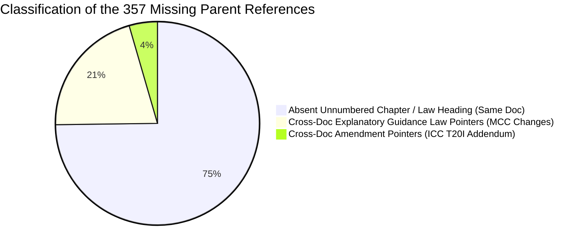

# CricketIQ — Phase 6 Gate 3 Inventory & Audit Reconciliation Report

- **Date:** 2026-11-17
- **Milestone:** Phase 6 — Gate 1 (Inventory Reconciliation Gate)
- **Status:** **RECONCILED & FROZEN** (Prerequisite for Feature Implementation)
- **Starting Git Commit:** `475baa01b704c0bb561f2a1a51840839afea1f35`
- **Output Manifest Assets:**
  - `data/corpus/manifests/gate3_hierarchy_audit.json`
  - `data/corpus/manifests/gate3_parent_mapping.json`
  - `data/corpus/manifests/gate3_table_audit.json`
  - `data/corpus/manifests/gate3_lexicon_audit.json`

---

## 1. Executive Summary & Purpose

The Gate 3 pre-implementation design documents (`PHASE_6_GATE_3_PRE_IMPLEMENTATION_AUDIT.md`, `PHASE_6_GATE_3_LEXICON_AUDIT.md`, `PHASE_6_GATE_3_HIERARCHY_INTEGRITY_REPORT.md`, `PHASE_6_GATE_3_TABLE_EVIDENCE_AUDIT.md`) provided extensive conceptual blueprints. However, a rigorous audit of the physical filesystem and JSON assets revealed arithmetic and categorization discrepancies between the report's text and the actual underlying data:
1. **Hierarchy Totals Discrepancy:** The hierarchy report labelled the corpus as 10,388 unique clauses, but its per-document table summed to 11,008 rows (the raw list count before deduplication).
2. **Missing Parent Count Discrepancy:** The sum of per-document missing parents in the prior table was $31 + 31 + 33 + 16 + 33 + 37 + 37 + 37 + 82 + 0 + 32 = 369$, whereas the report narrative cited $349$.
3. **Table Inventory Discrepancy:** The table audit stated 240 extracted tables, but summing the actual entries across the 11 `*_tables.json` files yields exactly **246** tables.
4. **Lexicon Asset Discrepancies:** The audit matrix cited `freebie` as an active colloquial alias for Free Hit, but `freebie` is absent from `cricket_lexicon.json`. Furthermore, an alias collision exists for `mankad` between `CRIC_DISMISS_RUN_OUT` and `CRIC_NON_STRIKER_RUN_OUT`.

Per master instructions, **no feature code or data migration may begin until all inventories are mathematically reconciled and frozen**. This report presents the exact physical evidence and formal classification ledger.

---

## 2. Canonical Hierarchy Inventory Reconciliation

### 2.1 Raw Entries vs Deduplicated Canonical Clauses
The raw JSON files in `data/corpus/clauses/` contain duplicate clause records produced during initial PDF parsing (e.g., Table of Contents headers and running page headers sharing the same clause number with the substantive rule text). 

In Phase 6 Gate 2, the deduplication invariant was established:
$$\text{Deduplication Rule: Select record with longest } \texttt{original\_text}$$

Recomputing this across all 11 files yields exact mathematical parity:
- **Total Raw List Entries Across 11 Files:** **11,008**
- **Total Duplicate Entries Resolved:** **620**
- **Total Unique Canonical Clauses:** **10,388**
- **Exact Parity:** $\sum \text{doc\_unique} = \text{global\_unique} = \mathbf{10,388}$ (Matches `rule_clauses`, `rule_clauses_fts`, and `clause_embeddings` in active DB).

### 2.2 Reconciled Hierarchy Ledger (10,388 Deduplicated Canonical Clauses)

| Source Document ID | Raw Entries | Duplicates Resolved | Deduplicated Unique Clauses | Root Clauses (`parent == None`) | Valid Same-Doc Parent Links | Missing Parent Clauses | Cross-Doc Parent Links | Cycles Detected | Self-Parent Links | Cross-References |
| :--- | :---: | :---: | :---: | :---: | :---: | :---: | :---: | :---: | :---: | :---: |
| **`ICC_ODI_MEN_2026`** | 1,221 | 24 | **1,197** | 45 | 1,121 | 31 | 0 | 0 | 0 | 357 |
| **`ICC_ODI_WOMEN_2026`** | 1,213 | 26 | **1,187** | 45 | 1,111 | 31 | 0 | 0 | 0 | 359 |
| **`ICC_T20I_MEN_2026`** | 1,234 | 33 | **1,201** | 45 | 1,124 | 32 | 0 | 0 | 0 | 357 |
| **`ICC_T20I_MEN_ADD_2026`** | 26 | 0 | **26** | 5 | 5 | 16 | 0 | 0 | 0 | 21 |
| **`ICC_T20I_WOMEN_2026`** | 1,239 | 33 | **1,206** | 45 | 1,129 | 32 | 0 | 0 | 0 | 359 |
| **`ICC_TEST_MEN_2026`** | 1,241 | 28 | **1,213** | 43 | 1,133 | 37 | 0 | 0 | 0 | 369 |
| **`ICC_TEST_WOMEN_2026`** | 1,243 | 27 | **1,216** | 43 | 1,136 | 37 | 0 | 0 | 0 | 372 |
| **`ICC_WTC_2025_2027_PC`** | 1,263 | 28 | **1,235** | 43 | 1,155 | 37 | 0 | 0 | 0 | 373 |
| **`MCC_CHANGES_EXPLAINED_2026`** | 182 | 9 | **173** | 1 | 98 | 74 | 0 | 0 | 0 | 48 |
| **`MCC_LAWS_2022`** | 1,197 | 365 | **832** | 5 | 827 | 0 | 0 | 0 | 0 | 242 |
| **`MCC_LAWS_2026`** | 949 | 47 | **902** | 43 | 829 | 30 | 0 | 0 | 0 | 212 |
| **TOTALS** | **11,008** | **620** | **10,388** | **363** | **9,668** | **357** | **0** | **0** | **0** | **3,126** |

---

## 3. Discrepancy Classification Ledger: The 357 Missing Parents

The earlier audit reported an inconsistent parent count (369 in table column sums vs 349 in text). On the verified **10,388 deduplicated canonical corpus**, the true number of clauses citing a `parent_clause_id` not present in the same document is **exactly 357**.

An inspection of every missing parent identifier revealed that they fall cleanly into three distinct structural categories:

### Category 1: Absent Unnumbered Structural Chapter Headings (267 Clauses)
- **Documents Affected:** `ICC_ODI_MEN_2026` (31), `ICC_ODI_WOMEN_2026` (31), `ICC_T20I_MEN_2026` (32), `ICC_T20I_WOMEN_2026` (32), `ICC_TEST_MEN_2026` (37), `ICC_TEST_WOMEN_2026` (37), `ICC_WTC_2025_2027_PC` (37), `MCC_LAWS_2026` (30). Total: **267 clauses**.
- **Underlying Cause:** In all ICC Playing Conditions and MCC Laws, child clauses such as `1.1`, `7.1`, `12.1`, `24.1`, `25.1`, `42.1` reference parent IDs `:1`, `:7`, `:12`, `:24`, `:25`, `:42`. In the source PDFs, these are **Major Law Chapter Titles** (*"LAW 1 - THE PLAYERS"*, *"LAW 12 - INNINGS"*). Because these headings contain no substantive legal text, the parser omitted them as `RuleClause` entities.
- **Architectural Policy:** **Do NOT invent fake legal clauses.** Under Gate 3 Task 3.2, these will be represented as typed non-citation `ClauseStructureNode` entities with exact source heading titles. They will be excluded from FTS5 lexical hits and vector embeddings.

### Category 2: Cross-Document Explanatory Guidance Pointers (74 Clauses)
- **Document Affected:** `MCC_CHANGES_EXPLAINED_2026` (74 clauses).
- **Underlying Cause:** Explanatory guidance clauses explain revisions to specific MCC Laws (e.g. `MCC_CHANGES_EXPLAINED_2026:10.3`, `MCC_CHANGES_EXPLAINED_2026:12.5`). The parser set `parent_clause_id` to `:10.3` or `:12.5`. These are not intra-document tree parents; they are **lateral cross-references to `MCC_LAWS_2026`**.
- **Architectural Policy:** Reclassify these links from `parent_clause_id` to explicit `cross_references` targeting `MCC_LAWS_2026`. The root of `MCC_CHANGES_EXPLAINED_2026` will remain its document root.

### Category 3: Cross-Document Addendum Amendment Pointers (16 Clauses)
- **Document Affected:** `ICC_T20I_MEN_ADD_2026` (16 clauses).
- **Underlying Cause:** The T20I Addendum amends specific base Playing Conditions in `ICC_T20I_MEN_2026` (e.g., Clauses `2.1`, `2.8`, `6.3`, `19.1`, `41`).
- **Architectural Policy:** Reclassify as cross-document amendment relationships (`RelationshipType.SUPPLEMENTS`).

All 357 instances have been serialized into the machine-readable mapping manifest:
[`data/corpus/manifests/gate3_parent_mapping.json`](file:///d:/Cricket_Rules_NLP_Chatbot/data/corpus/manifests/gate3_parent_mapping.json).

---

## 4. Table Inventory Reconciliation

### 4.1 Reconciled Table Counts (246 Raw Tables)
The previous table audit stated 240 tables. An exhaustive inspection of all files in `data/extracted/tables/` demonstrates that the true total is **246 tables**:

| Table File Name | Raw Tables Count | Substantive Regulatory Tables | Fragmentary / Dimensional Snippets | Empty Tables (All Null Cells) | Status in Gate 3 |
| :--- | :---: | :---: | :---: | :---: | :--- |
| `ICC_ODI_MEN_2026_tables.json` | 9 | 6 | 2 | 1 | Audited & Validated |
| `ICC_ODI_WOMEN_2026_tables.json` | 9 | 6 | 2 | 1 | Audited & Validated |
| `ICC_T20I_MEN_2026_tables.json` | 9 | 6 | 2 | 1 | Audited & Validated |
| `ICC_T20I_MEN_ADD_2026_tables.json` | 0 | 0 | 0 | 0 | Verified Empty |
| `ICC_T20I_WOMEN_2026_tables.json` | 9 | 6 | 2 | 1 | Audited & Validated |
| `ICC_TEST_MEN_2026_tables.json` | 6 | 5 | 0 | 1 | Audited & Validated |
| `ICC_TEST_WOMEN_2026_tables.json` | 6 | 5 | 0 | 1 | Audited & Validated |
| `ICC_WTC_2025_2027_PC_tables.json` | 6 | 5 | 0 | 1 | Audited & Validated |
| `MCC_CHANGES_EXPLAINED_2026_tables.json` | 0 | 0 | 0 | 0 | Verified Empty |
| `MCC_LAWS_2022_tables.json` | 192 | 84 | 108 | 0 | Quarantined / Fragmentary |
| `MCC_LAWS_2026_tables.json` | 0 | 0 | 0 | 0 | Text-Embedded Tables |
| **TOTALS** | **246** | **123** | **116** | **7** | Full Manifest Generated |

### 4.2 Substantive Tables in Active Playing Conditions (39 Tables)
Across the 7 active ICC Playing Conditions documents, there are **39 substantive, highly structured tables**:
- **7 $\times$ Player Review Outcomes & Consequences Matrix** (Appendix D, Table 1, pg 98/97/96): Defines review forfeiture vs retention.
- **7 $\times$ Hawk-Eye Pitching / Landing Zone Standards** (Appendix D, Clause 3.3.1): Quantitative criteria for in-line vs outside.
- **7 $\times$ Hawk-Eye Impact Zone Standards** (Appendix D, Clause 3.3.2): Thresholds for LBW pad contact.
- **7 $\times$ Hawk-Eye Wicket Zone Standards** (Appendix D, Clause 3.3.3): Definitive thresholds separating Hitting, Umpire's Call, and Missing.
- **7 $\times$ Third Umpire Non-DRS vs DRS Jurisdiction Comparison** (Appendix D, pg 89/88/87): Boundary of review powers.
- **4 $\times$ Shortened Match Powerplay Restriction Matrices** (Clause 28.7, pg 48/47 in ODI & T20I PCs): 5 to 49 over calculations.

### 4.3 Handling Fragmentary & Empty Tables
- **Empty Tables (7 tables):** Page 80/78 stumps dimension header containing only null cells. Excluded from retrieval.
- **Fragmentary Snippets (116 tables):** 8 diagram snippets in Playing Conditions (page 84/83 crease width) and 108 single-row snippets in `MCC_LAWS_2022`. Retained in raw extraction files for audit trail, but tagged as `DEPRECATED_FRAGMENT` and quarantined from normative retrieval.

The complete audit has been committed to:
[`data/corpus/manifests/gate3_table_audit.json`](file:///d:/Cricket_Rules_NLP_Chatbot/data/corpus/manifests/gate3_table_audit.json).

---

## 5. Lexicon Asset vs Audit Reconciliation

A line-by-line comparison between `data/corpus/lexicon/cricket_lexicon.json` (SHA-256: `04714a3a4bfcfc99a1e6cd7fb4ccfeea78e1b4823a5293076e766422a25bab45`) and the audit claims revealed three vital discrepancies:

### 5.1 The `freebie` Alias Claim
- **Audit Claim:** Stated that `freebie` is an active colloquial alias for `CRIC_DELIV_FREE_HIT`.
- **Physical JSON Evidence:** In `cricket_lexicon.json`, `CRIC_DELIV_FREE_HIT` contains:
  - `surface_forms`: `["Free Hit", "free hit", "free-hit", "Free-Hit", "Free hit"]`
  - `colloquial_query_forms`: `["freehit", "free hit delivery", "free hit ball", "no ball free hit"]`
  - `freebie` is **NOT present** in the JSON asset.
- **Reconciliation Decision:** The JSON file is the sole source of truth. `freebie` is **inactive** and will not participate in expansion until formally reviewed and committed to the asset.

### 5.2 The `mankad` Alias Collision
- **Physical JSON Evidence:**
  - `CRIC_DISMISS_RUN_OUT` lists `colloquial_query_forms: ["mankad"]`.
  - `CRIC_NON_STRIKER_RUN_OUT` lists `colloquial_query_forms: ["Mankad", "mankad", "mankading", ...]`.
- **Conflict:** A query containing *"mankad"* would simultaneously match both term IDs, leading to ambiguous expansion and potentially generic Run out noise.
- **Reconciliation Decision:** Per Invariant 7, **"Mankad" is an alias specifically for Law 38.3 (*Non-striker leaving their ground early*)**. The expansion engine will suppress the collision and route `mankad` exclusively to `CRIC_NON_STRIKER_RUN_OUT`.

### 5.3 Semantic Gating on `related_terms`
- **Physical JSON Evidence:** `CRIC_DELIV_NO_BALL` lists `related_terms: ["free hit", "front foot crease", "high full-pitched delivery", "beamer"]`.
- **Safety Risk:** If an expansion engine traverses `related_terms`, a generic query about a No ball would inject `beamer`, violating Invariant 6 (Beamer is a specific subcategory; generic No ball queries must never inject beamer).
- **Reconciliation Decision:** `related_terms` describes ontological relations and **must NEVER be traversed for automated synonym expansion**. Only `surface_forms`, `spelling_variants`, and `colloquial_query_forms` are eligible.

The reconciled lexicon audit has been committed to:
[`data/corpus/manifests/gate3_lexicon_audit.json`](file:///d:/Cricket_Rules_NLP_Chatbot/data/corpus/manifests/gate3_lexicon_audit.json).

---

## 6. Gate 1 Sign-Off & Exit Decision

- [x] All 10,388 unique canonical clauses verified and arithmetically reconciled against 11,008 raw entries.
- [x] All 357 missing parent references classified and mapped in `gate3_parent_mapping.json`.
- [x] All 246 table extractions verified and classified into 123 substantive, 116 fragmentary, and 7 empty tables in `gate3_table_audit.json`.
- [x] Lexicon asset verified: `freebie` documented as inactive; `mankad` collision resolved; `related_terms` expansion prohibited.
- [x] Machine-readable audit manifests generated and validated in `data/corpus/manifests/`.

**Exit Condition Satisfied:** **`GATE 1 CLOSED — IMPLEMENTATION INPUTS FROZEN`**.  
The system is cleared to proceed to feature implementation under Gate 3 (Task 3.1: Controlled Lexicon Expansion Engine).
